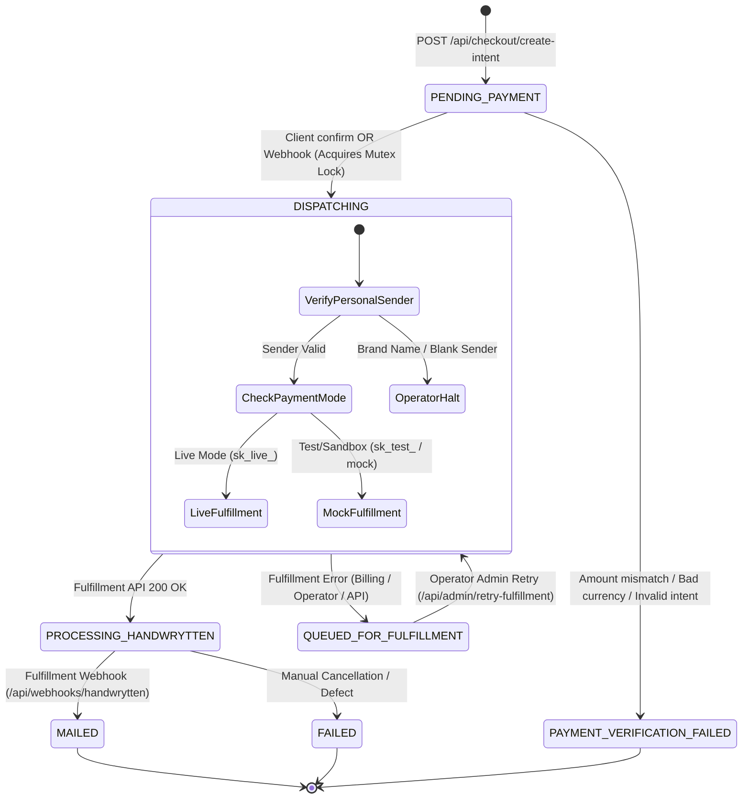

# SendMyNotes Architecture & Commerce Engine Reference

**Document Version:** 2.0.0  
**Audit Baseline:** October 14, 2026  
**Audience:** Platform Architects, Autonomous Coding Agents, and Fork Maintainers  
**Companion Documents:** [`docs/CANONICAL_PROJECT_BRIEF.md`](file:///Users/zeke/code/sendmynotes/docs/CANONICAL_PROJECT_BRIEF.md), [`docs/CANONICAL_PRODUCT_SPECS.md`](file:///Users/zeke/code/sendmynotes/docs/CANONICAL_PRODUCT_SPECS.md)

---

## Executive Summary & Architectural Split

`sendmynotes` is a full-stack, headless-ready micro-commerce application developed on Next.js 15, React 19, Google Cloud Firestore, and Stripe Elements. It is architected around two decoupled layers:

1. **The Reusable Commerce Spine (`[CORE SPINE - KEEP]`)**:  
   A production-hardened transaction engine that manages customer sessions, stateful draft persistence, Stripe PaymentIntents, 1-tap mobile wallets (Apple Pay & Google Pay), multi-phase payment verification, fail-closed idempotent webhook dispatch, database transaction locks, automated incident recording, and dual-layer conversion attribution (Google Ads Enhanced Conversions + Meta CAPI).
2. **The Domain-Specific Stationery Layer (`[BRAND/DOMAIN SPECIFIC - REPLACE]`)**:  
   The bespoke greeting card logic consisting of automated robotic pen fulfillment (Handwrytten API v2), tactile 3D card canvas previews, generative AI cover art (Google Imagen 3 / Gemini), handwriting SVG font simulation, and artisanal stationery theming.

```mermaid
flowchart TD
    subgraph Client["Browser Client (Mobile & Desktop)"]
        UI["Landing & Builder Flow<br/>(Candidate v3 / Etiquette Scenarios)"]
        Draft["Draft Store (SessionStorage)<br/>24h TTL, Allowlisted Sanitization"]
        Wallets["Stripe ExpressCheckoutElement<br/>(1-Tap Apple Pay / Google Pay)"]
        Elements["Stripe PaymentElement<br/>(Encrypted Card Tabs)"]
        Track["Attribution Tracker & Telemetry<br/>(UTMs, GCLID, FBCLID, _fbp, _fbc, GPC)"]
    end

    subgraph ServerSpine["Reusable Commerce Spine (KEEP IN FORKS)"]
        API_Intent["/api/checkout/create-intent<br/>(Crypto Order IDs, Discounts, Totals)"]
        API_Confirm["/api/checkout/confirm-order<br/>(Synchronous PaymentIntent Verification)"]
        API_Webhook["/api/webhooks/stripe<br/>(Fail-Closed Webhook Verification)"]
        Processor["lib/order-processor.ts<br/>(Firestore Atomic Mutex Locking)"]
        DB[(Cloud Firestore / Mock Store)<br/>Orders, Telemetry, Incidents, Settings]
        CAPI["Meta Conversions API (v19.0)<br/>SHA-256 PII Hashing + Deduplication"]
        Resend["lib/email-alerts.ts<br/>(Resend REST API Notifications)"]
    end

    subgraph StationeryDomain["Stationery Domain Layer (REPLACE IN FORKS)"]
        Handwrytten["Handwrytten API v2<br/>(Dimension 4 Folded A2, Real Pens)"]
        HW_Webhook["/api/webhooks/handwrytten<br/>(USPS Tracking & Status Ingestion)"]
        Gemini["Google Gemini / Imagen 3<br/>(Cover Art & Sentiment Generation)"]
        HW_Fonts["Local TTF Fonts & SVG Mapping<br/>(Adam, Charity, Chase, David, Kate, Will)"]
    end

    UI --> Draft
    UI --> Track
    UI --> API_Intent
    API_Intent --> DB
    API_Intent --> Wallets
    API_Intent --> Elements

    Wallets --> API_Confirm
    Elements --> API_Confirm
    API_Confirm --> Processor
    API_Webhook --> Processor
    Processor --> DB
    Processor --> CAPI
    Processor --> Resend

    Processor -.->|Fulfillment Adapter| Handwrytten
    Handwrytten -.-> HW_Webhook
    HW_Webhook --> DB
    UI -.-> Gemini
    UI -.-> HW_Fonts
```

---

## 1. System Overview & Tech Stack

| Layer | Technology | Version | Location / Source of Truth |
| :--- | :--- | :--- | :--- |
| **Framework** | Next.js (App Router) | `^15.1.7` | [`package.json`](file:///Users/zeke/code/sendmynotes/package.json), [`next.config.ts`](file:///Users/zeke/code/sendmynotes/next.config.ts) |
| **Runtime & Language** | Node.js 20+ / TypeScript | `^5.7.3` | [`tsconfig.json`](file:///Users/zeke/code/sendmynotes/tsconfig.json) |
| **UI Library** | React | `^19.0.0` | [`package.json`](file:///Users/zeke/code/sendmynotes/package.json) |
| **Styling Engine** | Tailwind CSS | `^3.4.17` | [`tailwind.config.ts`](file:///Users/zeke/code/sendmynotes/tailwind.config.ts), [`app/globals.css`](file:///Users/zeke/code/sendmynotes/app/globals.css) |
| **Icons & Micro-animations** | Lucide React, Canvas Confetti | `^0.475.0`, `^1.9.4` | [`package.json`](file:///Users/zeke/code/sendmynotes/package.json) |
| **Database & ORM** | Google Cloud Firestore (Dual-Mode: Real SDK or Disk-Persisted Mock) | `firebase-admin ^13.1.0`, `firebase ^12.19.0` | [`lib/firebase-admin.ts`](file:///Users/zeke/code/sendmynotes/lib/firebase-admin.ts), [`lib/firebase-client.ts`](file:///Users/zeke/code/sendmynotes/lib/firebase-client.ts) |
| **Payment Gateway** | Stripe Elements & PaymentIntents | `stripe ^17.6.0`, `@stripe/stripe-js ^5.6.0`, `@stripe/react-stripe-js ^3.1.1` | [`lib/stripe.ts`](file:///Users/zeke/code/sendmynotes/lib/stripe.ts), [`lib/payment-mode.ts`](file:///Users/zeke/code/sendmynotes/lib/payment-mode.ts) |
| **Stripe API Version** | `2025-01-27.acacia` | Acacia | [`lib/stripe.ts`](file:///Users/zeke/code/sendmynotes/lib/stripe.ts#L12) |
| **Image Processing** | Sharp (300 DPI A2 print rendering, MozJPEG 4:4:4) | `^0.35.5` | [`lib/image-optimizer.ts`](file:///Users/zeke/code/sendmynotes/lib/image-optimizer.ts) |
| **Email Dispatch** | Resend API (Direct REST Fetch) | API v1 | [`lib/email-alerts.ts`](file:///Users/zeke/code/sendmynotes/lib/email-alerts.ts) |
| **Hosting & Cloud Runtime** | Firebase App Hosting / Google Cloud Run | Node.js 20 runtime | [`apphosting.yaml`](file:///Users/zeke/code/sendmynotes/apphosting.yaml), [`firebase.json`](file:///Users/zeke/code/sendmynotes/firebase.json) |
| **Secrets Management** | Google Cloud Secret Manager | Native Cloud Run IAM | [`apphosting.yaml`](file:///Users/zeke/code/sendmynotes/apphosting.yaml#L13-L39) |
| **Domain Association** | Apple Pay Developer Merchant Association | Static Route | [`app/.well-known/apple-developer-merchantid-domain-association/route.ts`](file:///Users/zeke/code/sendmynotes/app/.well-known/apple-developer-merchantid-domain-association/route.ts) |

---

## 2. Directory & Module Map

Every file and directory in the project is cataloged below with its architectural classification:
- `[CORE SPINE - KEEP]`: Platform infrastructure, payment flows, database transactions, telemetry, and security primitives to preserve across all forks.
- `[BRAND/DOMAIN SPECIFIC - REPLACE]`: Stationery models, greeting card previews, robotic handwriting integrations, and artisanal brand styling to swap out when launching new products like `DocketStamp`.

```text
sendmynotes/
├── .data/                                    # [CORE SPINE - KEEP] Local persistent dev store
│   └── mock-firestore.json                   # [CORE SPINE - KEEP] Auto-generated local DB mock
├── .env.example                              # [CORE SPINE - KEEP] Config template for secrets
├── .firebaserc                               # [CORE SPINE - KEEP] Firebase project binding
├── firebase.json                             # [CORE SPINE - KEEP] App Hosting backend config
├── apphosting.yaml                           # [CORE SPINE - KEEP] Secret Manager & Cloud Run spec
├── next.config.ts                            # [CORE SPINE - KEEP] Image domains & redirects
├── package.json                              # [CORE SPINE - KEEP] Dependency manifest
├── tailwind.config.ts                        # [BRAND/DOMAIN SPECIFIC - REPLACE] Palette & typography
├── tsconfig.json                             # [CORE SPINE - KEEP] Strict TS compilation
│
├── app/
│   ├── .well-known/
│   │   └── apple-developer-merchantid-domain-association/
│   │       └── route.ts                      # [CORE SPINE - KEEP] Apple Pay domain proof
│   ├── account/
│   │   └── page.tsx                          # [CORE SPINE - KEEP] User order history & addresses
│   ├── admin/
│   │   ├── feature-flags/
│   │   │   └── page.tsx                      # [CORE SPINE - KEEP] Operator flags toggle
│   │   └── page.tsx                          # [CORE SPINE - KEEP] Operations dashboard
│   ├── api/
│   │   ├── account/
│   │   │   └── route.ts                      # [CORE SPINE - KEEP] Customer profile CRUD
│   │   ├── admin/
│   │   │   ├── ad-spend/route.ts             # [CORE SPINE - KEEP] Ad spend & CPA ingestion
│   │   │   ├── auth/route.ts                 # [CORE SPINE - KEEP] Timing-safe HMAC session auth
│   │   │   ├── discounts/route.ts            # [CORE SPINE - KEEP] Promo code CRUD
│   │   │   ├── dispatch-comp/route.ts        # [BRAND/DOMAIN SPECIFIC - REPLACE] Studio comp card
│   │   │   ├── feature-flags/route.ts        # [CORE SPINE - KEEP] Runtime flag controller
│   │   │   ├── handwrytten-balance/route.ts  # [BRAND/DOMAIN SPECIFIC - REPLACE] HW credit check
│   │   │   ├── incidents/route.ts            # [CORE SPINE - KEEP] Operational incident feed
│   │   │   ├── metrics/route.ts              # [CORE SPINE - KEEP] Conversion funnel analytics
│   │   │   ├── order-proof/route.ts          # [BRAND/DOMAIN SPECIFIC - REPLACE] Print canvas proof
│   │   │   ├── retry-fulfillment/route.ts    # [CORE SPINE - KEEP] Manual queue retry trigger
│   │   │   ├── scenarios/route.ts            # [BRAND/DOMAIN SPECIFIC - REPLACE] SEO scenario metrics
│   │   │   ├── sync-handwrytten/route.ts     # [BRAND/DOMAIN SPECIFIC - REPLACE] Supplier order poll
│   │   │   ├── sync-stripe/route.ts          # [CORE SPINE - KEEP] Stripe payment reconciler
│   │   │   ├── test-meta-capi/route.ts       # [CORE SPINE - KEEP] CAPI diagnostics endpoint
│   │   │   └── valuation-assumptions/route.ts# [CORE SPINE - KEEP] Unit economics modeler
│   │   ├── checkout/
│   │   │   ├── complete-free-order/route.ts  # [CORE SPINE - KEEP] $0.00 Promo code order flow
│   │   │   ├── confirm-order/route.ts        # [CORE SPINE - KEEP] Synchronous PI check & dispatch
│   │   │   └── create-intent/route.ts        # [CORE SPINE - KEEP] PI generation & order record
│   │   ├── discount/
│   │   │   └── validate/route.ts             # [CORE SPINE - KEEP] Promo code calculation
│   │   ├── feedback/route.ts                 # [CORE SPINE - KEEP] User feedback collector
│   │   ├── generate-cover/route.ts           # [BRAND/DOMAIN SPECIFIC - REPLACE] AI cover art API
│   │   ├── orders/[id]/route.ts              # [CORE SPINE - KEEP] Order retrieval & PII redaction
│   │   ├── reminders/route.ts                # [CORE SPINE - KEEP] Occasion reminder scheduler
│   │   ├── telemetry/route.ts                # [CORE SPINE - KEEP] First-party visitor telemetry
│   │   └── webhooks/
│   │       ├── handwrytten/route.ts          # [BRAND/DOMAIN SPECIFIC - REPLACE] HW status listener
│   │       └── stripe/route.ts               # [CORE SPINE - KEEP] Idempotent Stripe webhook
│   ├── globals.css                           # [BRAND/DOMAIN SPECIFIC - REPLACE] Custom CSS/fonts
│   ├── layout.tsx                            # [CORE SPINE - KEEP structure, REPLACE metadata/fonts]
│   ├── new/page.tsx                          # [BRAND/DOMAIN SPECIFIC - REPLACE] Direct builder route
│   ├── order/[id]/
│   │   ├── layout.tsx                        # [CORE SPINE - KEEP] Order page layout wrapper
│   │   └── page.tsx                          # [CORE SPINE - KEEP engine, REPLACE preview widget]
│   ├── page.tsx                              # [BRAND/DOMAIN SPECIFIC - REPLACE] Landing / Router
│   ├── preview/                              # [BRAND/DOMAIN SPECIFIC - REPLACE] Legacy preview
│   ├── privacy/page.tsx                      # [CORE SPINE - KEEP structure, REPLACE brand strings]
│   ├── return-policy/page.tsx                # [CORE SPINE - KEEP structure, REPLACE brand terms]
│   ├── robots.ts                             # [CORE SPINE - KEEP] Dynamic robots.txt
│   ├── send/                                 # [BRAND/DOMAIN SPECIFIC - REPLACE] Etiquette SEO pages
│   ├── sitemap.ts                            # [CORE SPINE - KEEP structure, REPLACE scenario URLs]
│   └── terms/page.tsx                        # [CORE SPINE - KEEP structure, REPLACE brand terms]
│
├── components/
│   ├── admin/                                # [CORE SPINE - KEEP] Internal admin panel widgets
│   ├── flow/                                 # [CORE SPINE - KEEP] High-conversion checkout chassis
│   │   ├── ActionBar.tsx                     # [CORE SPINE - KEEP] Mobile sticky CTA bar (safe-area)
│   │   ├── EntryCardStep.tsx                 # [BRAND/DOMAIN SPECIFIC - REPLACE] Card picker screen
│   │   ├── FlowHeader.tsx                    # [CORE SPINE - KEEP] Mobile-optimized stepper header
│   │   ├── ProgressIndicator.tsx             # [CORE SPINE - KEEP] Visual step indicator
│   │   └── Sheet.tsx                         # [CORE SPINE - KEEP] Accessible slide-over drawer
│   ├── v3/                                   # [BRAND/DOMAIN SPECIFIC - REPLACE components]
│   │   ├── CustomAiCommissionDrawer.tsx      # [BRAND/DOMAIN SPECIFIC - REPLACE] AI art prompter
│   │   ├── Step1CardSelection.tsx            # [BRAND/DOMAIN SPECIFIC - REPLACE] Catalog selector
│   │   ├── Step2NoteComposition.tsx          # [BRAND/DOMAIN SPECIFIC - REPLACE] Note composition
│   │   ├── Step3EnvelopeAddressing.tsx       # [CORE SPINE - KEEP form UX, REPLACE envelope preview]
│   │   ├── Step4ReviewAndPayment.tsx         # [CORE SPINE - KEEP Stripe/Wallets, REPLACE card summary]
│   │   ├── Step5Confirmation.tsx             # [CORE SPINE - KEEP confirmation UX, REPLACE card art]
│   │   └── TargetPurchaseExperience.tsx      # [BRAND/DOMAIN SPECIFIC - REPLACE] Experience orchestrator
│   ├── AddressStep.tsx                       # [BRAND/DOMAIN SPECIFIC - REPLACE] Legacy address step
│   ├── AttributionTracker.tsx                # [CORE SPINE - KEEP] UTM / GCLID / FBCLID / GPC capturer
│   ├── AuthModal.tsx                         # [CORE SPINE - KEEP] Email magic link / auth modal
│   ├── CardFrontPreview.tsx                  # [BRAND/DOMAIN SPECIFIC - REPLACE] Card front renderer
│   ├── CardPreview.tsx                       # [BRAND/DOMAIN SPECIFIC - REPLACE] 3D folding card
│   ├── CheckoutStep.tsx                      # [CORE SPINE - KEEP] Classic Stripe Elements host
│   ├── ContactImportModal.tsx                # [CORE SPINE - KEEP] Address parser modal
│   ├── CoverStep.tsx                         # [BRAND/DOMAIN SPECIFIC - REPLACE] Legacy cover step
│   ├── ExperienceRouter.tsx                  # [CORE SPINE - KEEP] A/B flag experience router
│   ├── FeedbackModal.tsx                     # [CORE SPINE - KEEP] Customer feedback widget
│   ├── InsideNoteStep.tsx                    # [BRAND/DOMAIN SPECIFIC - REPLACE] Legacy interior step
│   └── VendingMachineBuilder.tsx             # [BRAND/DOMAIN SPECIFIC - REPLACE] Legacy UI builder
│
├── context/
│   └── AuthContext.tsx                       # [CORE SPINE - KEEP] Firebase Auth & address book state
│
├── lib/
│   ├── draft/                                # [CORE SPINE - KEEP] Versioned draft storage engine
│   │   ├── index.ts                          # [CORE SPINE - KEEP] Barrel export
│   │   ├── reducer.ts                        # [CORE SPINE - KEEP] Pure draft reducer
│   │   ├── store.ts                          # [CORE SPINE - KEEP] Sanitized sessionStorage manager
│   │   ├── types.ts                          # [CORE SPINE - KEEP structure, REPLACE domain fields]
│   │   └── use-draft.ts                      # [CORE SPINE - KEEP] React hook for draft lifecycle
│   ├── factory/                              # [BRAND/DOMAIN SPECIFIC - REPLACE] Legacy factory types
│   ├── admin-auth.ts                         # [CORE SPINE - KEEP] Timing-safe HMAC credentials
│   ├── admin-rate-limit.ts                   # [CORE SPINE - KEEP] Brute force mitigation
│   ├── card-intent.ts                        # [BRAND/DOMAIN SPECIFIC - REPLACE] Sentiment heuristics
│   ├── card-presets.ts                       # [BRAND/DOMAIN SPECIFIC - REPLACE] Preset card catalog
│   ├── contact-parser.ts                     # [CORE SPINE - KEEP] Address copy-paste NLP parser
│   ├── delivery-estimate.ts                  # [CORE SPINE - KEEP] Business-day & federal holiday math
│   ├── device-wallet.ts                      # [CORE SPINE - KEEP] Browser payment capabilities
│   ├── discount.ts                           # [CORE SPINE - KEEP] Promo validation & computation
│   ├── email-alerts.ts                       # [CORE SPINE - KEEP engine, REPLACE email templates]
│   ├── env-validator.ts                      # [CORE SPINE - KEEP] Security leak runtime check
│   ├── feature-flags.ts                      # [CORE SPINE - KEEP] Multi-source flag evaluation
│   ├── firebase-admin.ts                     # [CORE SPINE - KEEP] Server Firestore & ADC connection
│   ├── firebase-client.ts                    # [CORE SPINE - KEEP] Client Firebase SDK setup
│   ├── fonts.ts                              # [BRAND/DOMAIN SPECIFIC - REPLACE] Local handwriting fonts
│   ├── google-ads.ts                         # [CORE SPINE - KEEP] Enhanced conversions & GA4
│   ├── handwrytten.ts                        # [BRAND/DOMAIN SPECIFIC - REPLACE] Robotic pen client
│   ├── image-optimizer.ts                    # [BRAND/DOMAIN SPECIFIC - REPLACE] Sharp A2 print formatter
│   ├── incident-logger.ts                    # [CORE SPINE - KEEP] Structured system incident log
│   ├── meta-ads.ts                           # [CORE SPINE - KEEP] Meta Pixel browser events
│   ├── meta-conversions-api.ts               # [CORE SPINE - KEEP] Server CAPI dispatch & SHA-256
│   ├── metrics-rollup.ts                     # [CORE SPINE - KEEP] Analytics & margin aggregator
│   ├── nano-banana.ts                        # [BRAND/DOMAIN SPECIFIC - REPLACE] Imagen 3 client
│   ├── order-processor.ts                    # [CORE SPINE - KEEP] Atomic order state machine
│   ├── payment-mode.ts                       # [CORE SPINE - KEEP] Safe test/live mode resolution
│   ├── product-facts.ts                      # [BRAND/DOMAIN SPECIFIC - REPLACE] Canonical specs data
│   ├── rate-limiter.ts                       # [CORE SPINE - KEEP] Sliding-window IP rate limiter
│   ├── reminder-utils.ts                     # [CORE SPINE - KEEP] Date math for calendar events
│   ├── reminders.ts                          # [CORE SPINE - KEEP] Firestore reminder operations
│   ├── seo-scenarios.ts                      # [BRAND/DOMAIN SPECIFIC - REPLACE] Etiquette scenario data
│   ├── stripe.ts                             # [CORE SPINE - KEEP] Stripe client & intent builder
│   ├── telemetry-schema.ts                   # [CORE SPINE - KEEP] Strict telemetry schema validator
│   ├── telemetry.ts                          # [CORE SPINE - KEEP] Browser event transmitter
│   ├── thematic-sentiment.ts                 # [BRAND/DOMAIN SPECIFIC - REPLACE] Gemini prompt builder
│   ├── types.ts                              # [CORE SPINE - KEEP types, REPLACE domain types]
│   └── valuation-heuristics.ts               # [CORE SPINE - KEEP] LTV/CAC payback mathematics
│
├── public/
│   ├── .well-known/                          # [CORE SPINE - KEEP]
│   │   └── apple-developer-merchantid-domain-association # [CORE SPINE - KEEP] Apple verification
│   ├── ad-assets/                            # [BRAND/DOMAIN SPECIFIC - REPLACE] Ad photography
│   ├── fonts/                                # [BRAND/DOMAIN SPECIFIC - REPLACE] Handwriting TTF
│   ├── presets/                              # [BRAND/DOMAIN SPECIFIC - REPLACE] Card cover assets
│   ├── aster-blanche-backplate.png           # [BRAND/DOMAIN SPECIFIC - REPLACE] Back logo print
│   └── site.webmanifest                      # [BRAND/DOMAIN SPECIFIC - REPLACE] App manifest
│
└── scripts/                                  # [BRAND/DOMAIN SPECIFIC - REPLACE] Stationery scripts
```

---

## 3. End-to-End Order Lifecycle & State Machine

The transaction pipeline guarantees that under network partitions, concurrent webhooks, double clicks, and browser reloads, **an order is charged exactly once and fulfilled exactly once**.

### 3.1 Order State Machine Graph



### 3.2 Detailed Step-by-Step Execution Sequence

#### 1. Ingestion & Funnel State Persistence
- **Attribution Ingestion**: [`components/AttributionTracker.tsx`](file:///Users/zeke/code/sendmynotes/components/AttributionTracker.tsx) captures URL parameters (`utm_source`, `utm_medium`, `utm_campaign`, `gclid`, `fbclid`), browser cookies (`_fbp`, `_fbc`), and client signals (Global Privacy Control `navigator.globalPrivacyControl`). It persists them to `sessionStorage` and `localStorage` under `smn_attribution`.
- **Client Draft State**: [`lib/draft/use-draft.ts`](file:///Users/zeke/code/sendmynotes/lib/draft/use-draft.ts) manages interactive user inputs via a pure reducer ([`lib/draft/reducer.ts`](file:///Users/zeke/code/sendmynotes/lib/draft/reducer.ts)) backed by sanitized `sessionStorage` ([`lib/draft/store.ts`](file:///Users/zeke/code/sendmynotes/lib/draft/store.ts)). It enforces a 24-hour expiration window and strictly strips sensitive payment tokens (`clientSecret`, `card`, `viewToken`).

#### 2. Intent Creation (`POST /api/checkout/create-intent`)
- In [`app/api/checkout/create-intent/route.ts`](file:///Users/zeke/code/sendmynotes/app/api/checkout/create-intent/route.ts):
  - Validates recipient address (street, city, state, ZIP).
  - Validates return address via [`validatePersonalSender`](file:///Users/zeke/code/sendmynotes/lib/order-processor.ts#L37). Rejects brand names (e.g. "Aster & Blanche") to guarantee envelope compliance.
  - Generates unguessable 128-bit cryptographically secure IDs:
    - `orderId`: `order_${crypto.randomBytes(16).toString("hex")}`
    - `viewToken`: `tok_${crypto.randomBytes(16).toString("hex")}`
  - Evaluates discount codes via [`validateDiscount`](file:///Users/zeke/code/sendmynotes/lib/discount.ts): checks active status, expiration timestamp, and usage cap.
  - **100% Free Orders ($0.00)**: Saves order to Firestore with status `PENDING_PAYMENT`, `paymentMethod: "PROMO_CODE"`, and returns `isFree: true`. No Stripe PaymentIntent is generated.
  - **Paid Orders ($9.00 / Discounted)**: Calls [`createCardPaymentIntent`](file:///Users/zeke/code/sendmynotes/lib/stripe.ts#L35) setting `automatic_payment_methods: { enabled: true }` and metadata containing `orderId`. Saves the initial Order document in Firestore `orders` with status `PENDING_PAYMENT`.
  - Returns `{ orderId, viewToken, clientSecret, publishableKey, amountInCents }` to the client.

#### 3. Client Checkout Execution (Stripe Elements & 1-Tap Wallets)
- Hosted in [`components/v3/Step4ReviewAndPayment.tsx`](file:///Users/zeke/code/sendmynotes/components/v3/Step4ReviewAndPayment.tsx):
  - Injects `Elements` configured with `clientSecret` and theme variables.
  - Renders `ExpressCheckoutElement` with `onReady` detecting Apple Pay, Google Pay, or Link availability.
  - Form submit triggers `elements.submit()` to validate inputs, followed by `stripe.confirmPayment({ redirect: "if_required" })`.
  - Upon authorization (`paymentIntent.status === "succeeded"`), client immediately engages UI lock `setIsPaymentCaptured(true)` to prevent duplicate button clicks.
  - Dispatches synchronous confirmation payload to `/api/checkout/confirm-order`.

#### 4. Dual Confirmation: Synchronous Client vs. Asynchronous Webhook
To eliminate double dispatch, both the browser confirmation route and the Stripe webhook funnel into the exact same transactional mutex in [`lib/order-processor.ts`](file:///Users/zeke/code/sendmynotes/lib/order-processor.ts):

##### Path A: Synchronous Route (`POST /api/checkout/confirm-order`)
- In [`app/api/checkout/confirm-order/route.ts`](file:///Users/zeke/code/sendmynotes/app/api/checkout/confirm-order/route.ts):
  - Fetches the order by `orderId`. If already `DISPATCHING`, `PROCESSING_HANDWRYTTEN`, or `MAILED`, returns `{ alreadyProcessed: true }` immediately.
  - Directly retrieves the PaymentIntent from Stripe API (`stripe.paymentIntents.retrieve`).
  - **Fail-Closed Security Assertions**:
    - Asserts `pi.status === "succeeded"`.
    - Asserts `pi.currency === "usd"`.
    - Asserts `pi.amount === expectedAmountCents` (verifies customer paid the exact required total).
    - Asserts `pi.metadata.orderId === orderId`.
    - Asserts `pi.livemode === true` when running in `NODE_ENV === "production"`.
  - Calls `processPaidOrder(orderId, paymentIntentId, customerEmail, clientContext)`.

##### Path B: Asynchronous Webhook (`POST /api/webhooks/stripe`)
- In [`app/api/webhooks/stripe/route.ts`](file:///Users/zeke/code/sendmynotes/app/api/webhooks/stripe/route.ts):
  - Reads raw request body and verifies `stripe-signature` header via `constructWebhookEvent(rawBody, signature, secret)`.
  - Rejects without processing if `STRIPE_WEBHOOK_SECRET` is missing.
  - On `payment_intent.succeeded`: extracts `orderId` from metadata and calls `processPaidOrder(orderId, paymentIntent.id, receipt_email, options)`.

#### 5. Atomic Order Processor (`lib/order-processor.ts`)
- **Exclusive Mutex Lock via Firestore Transaction**:
  ```typescript
  await firestoreDb.runTransaction(async (transaction) => {
    const docRef = getOrdersCollection().doc(orderId);
    const snapshot = await transaction.get(docRef);
    const existingOrder = snapshot.data();

    // Check for active or recent lock (< 5 minutes old)
    const isStaleLock = existingOrder.status === "DISPATCHING" && 
      Date.now() - existingOrder.dispatchStartedAt > 5 * 60 * 1000;

    if ((existingOrder.status === "DISPATCHING" && !isStaleLock) ||
        existingOrder.status === "PROCESSING_HANDWRYTTEN" ||
        existingOrder.status === "MAILED") {
      throw new DuplicateDispatchError(existingOrder.status, existingOrder.handwryttenOrderId);
    }

    // Atomically claim DISPATCHING lock
    transaction.update(docRef, {
      status: "DISPATCHING",
      stripePaymentId: paymentIntentId,
      dispatchStartedAt: Date.now(),
      updatedAt: Date.now(),
    });
  });
  ```
- **Authority Event Telemetry**: Emits server authority event `purchase_verified` (unforgeable from client).
- **Discount Increment**: Records promo usage counter atomically in Firestore.
- **Test Mode Safety Boundary**:
  - If `paymentMode` is `stripe_test` or `local_mock`, **live physical fulfillment is strictly bypassed**, assigning mock supplier ID `test_hw_${orderId}`. Real cards are never mailed on test charges.
- **Physical Fulfillment Dispatch**:
  - In live mode, dispatches order to supplier with deterministic `orderId` for supplier-side idempotency.
  - If fulfillment fails or declines (e.g., supplier account balance depleted, invalid recipient address):
    - Sets order status to `QUEUED_FOR_FULFILLMENT`.
    - Emits `fulfillment_failed` telemetry.
    - Records structured `SystemIncident` categorized as `STUDIO_BILLING`, `OPERATOR_ACTION`, or `TRANSIENT`.
  - If fulfillment succeeds:
    - Transitions order status to `PROCESSING_HANDWRYTTEN` with `handwryttenOrderId`.
    - Auto-resolves any open incidents for this order.
    - Emits `fulfillment_submitted` server telemetry.
    - Dispatches server-side **Meta Conversions API (CAPI)** Purchase event with SHA-256 hashed user data and deduplication `event_id: orderId`.

#### 6. Supplier Webhook Updates (`POST /api/webhooks/handwrytten`)
- In [`app/api/webhooks/handwrytten/route.ts`](file:///Users/zeke/code/sendmynotes/app/api/webhooks/handwrytten/route.ts):
  - Validates `HANDWRYTTEN_WEBHOOK_SECRET` token if configured.
  - Extracts supplier order ID and queries matching order in Firestore.
  - Updates order status to `MAILED` when status includes `"mail"`, `"ship"`, or `"complete"`.
  - Persists `handwryttenTrackingNumber`, `handwryttenTrackingUrl`, and `handwryttenMailedDate`.

#### 7. Customer Tracking Page & Privacy (`/order/[id]`)
- In [`app/order/[id]/page.tsx`](file:///Users/zeke/code/sendmynotes/app/order/[id]/page.tsx) and [`app/api/orders/[id]/route.ts`](file:///Users/zeke/code/sendmynotes/app/api/orders/[id]/route.ts):
  - **Zero-Trust Public Privacy**: If accessed without the cryptographic `viewToken` or admin key, all PII is redacted (email masked, street masked to `••••••••`, ZIP masked to `•••••`, note text hidden).
  - Verification Challenge: Allows customer or recipient to unlock the full order by submitting their billing email or delivery ZIP code (rate-limited to 5 attempts per 15 minutes).
  - Client Conversion Attribution: Fires browser `trackGoogleAdsPurchase` and `trackMetaPurchase` using `sessionStorage` flags (`gads_conv_${orderId}`, `meta_conv_${orderId}`) to eliminate multi-reload duplicate conversions.

---

## 4. Mobile Checkout & Conversion Polish Inventory

The repository contains extensive production engineering specifically optimized for mobile Safari, Meta in-app browsers, and touch interfaces:

### 4.1 Viewport, Safe Area, and Layout Architecture
- **Sticky Bottom Action Bar**:  
  Implemented in [`components/flow/ActionBar.tsx`](file:///Users/zeke/code/sendmynotes/components/flow/ActionBar.tsx) and [`components/v3/Step4ReviewAndPayment.tsx`](file:///Users/zeke/code/sendmynotes/components/v3/Step4ReviewAndPayment.tsx#L796). Uses `fixed bottom-0 left-0 right-0 z-40 bg-white/95 backdrop-blur-md border-t`.
- **CSS Safe Area Insets**:  
  Bottom padding dynamic calculation: `pb-[max(0.75rem,env(safe-area-inset-bottom))]` guarantees the CTA button never collides with the iOS home indicator bar on notched screens.
- **Content Scroll Clearance**:  
  Scroll containers feature `pb-28 md:pb-12` so all input fields, radio buttons, and summary elements can be scrolled cleanly into view above the fixed mobile bar.

### 4.2 iOS Safari Form Handling & Input Optimization
- **Auto-Zoom Elimination (16px Font Threshold)**:  
  In iOS Safari, focusing any input with `font-size < 16px` forces the browser to zoom the entire page, breaking sticky headers and footers. All input elements in [`Step3EnvelopeAddressing.tsx`](file:///Users/zeke/code/sendmynotes/components/v3/Step3EnvelopeAddressing.tsx#L184) and [`Step4ReviewAndPayment.tsx`](file:///Users/zeke/code/sendmynotes/components/v3/Step4ReviewAndPayment.tsx#L568) explicitly specify `text-base` (16px) to keep the mobile viewport 100% stable.
- **Autofill & Autocomplete Attributes**:  
  Full compliance with browser credential and address managers:
  - Recipient: `autoComplete="shipping name"`, `shipping address-line1"`, `shipping address-line2"`, `shipping address-level2"`, `shipping address-level1"`, `shipping postal-code"`.
  - Sender: `autoComplete="billing name"`, `billing address-line1"`, etc.
  - Email: `type="email" inputMode="email" autoComplete="email" autoCapitalize="none" autoCorrect="off" spellCheck={false}`.
  - ZIP Code: `inputMode="numeric" maxLength={10}`.
- **Typing Hygiene**:  
  Names and streets enforce `autoCapitalize="words" autoCorrect="off" spellCheck={false}` to prevent aggressive autocorrect dictionary replacements on personal surnames and street designations.

### 4.3 1-Tap Digital Wallets (Apple Pay & Google Pay)
- **Stripe Express Checkout**:  
  Configured in [`components/v3/Step4ReviewAndPayment.tsx`](file:///Users/zeke/code/sendmynotes/components/v3/Step4ReviewAndPayment.tsx#L697) via `<ExpressCheckoutElement options={{ buttonHeight: 44 }} />`.
- **Wallet Readiness Detection**:  
  Listens to the `onReady` event. If `availablePaymentMethods.applePay` or `googlePay` is active, displays the 1-tap button above an elegant `"Or pay with card"` separator; otherwise cleanly falls back to the tabbed card form without jarring layout shifts.
- **Apple Touch Guidelines**:  
  All actionable buttons maintain a minimum tap target of `44px` height (`min-h-[44px]`) with responsive padding.

### 4.4 Conversion Safety & Anti-Replay Safeguards
- **Button Locking**:  
  Once Stripe captures a payment, the submit button locks into a disabled state displaying an animated spinner and text: `Payment Captured • Finalizing Order...`.
- **Session-Based Pixel Deduplication**:  
  Purchase conversion scripts in [`lib/google-ads.ts`](file:///Users/zeke/code/sendmynotes/lib/google-ads.ts#L177) and [`lib/meta-ads.ts`](file:///Users/zeke/code/sendmynotes/lib/meta-ads.ts#L285) write to `sessionStorage` before dispatching. Reloading `/order/[id]` will never fire a duplicate ad conversion event.
- **CAPI Event Matching**:  
  Browser Meta Pixel sends `{ eventID: orderId }`, while backend server CAPI dispatches `{ event_id: orderId }`. Meta automatically deduplicates these into a single verified purchase event with high match quality.

---

## 5. Environment Variables & External Secrets

### Group 1: Core Commerce & Infrastructure (KEEP IN FORKS)

| Variable | Environment | Type | Purpose | Production Secret Rule |
| :--- | :--- | :--- | :--- | :--- |
| `STRIPE_SECRET_KEY` | Server | Secret | Charges cards & creates PaymentIntents | Cloud Secret Manager (`stripe-secret-key`). Must start with `sk_live_`. |
| `STRIPE_WEBHOOK_SECRET` | Server | Secret | Verifies HMAC signatures on Stripe webhooks | Cloud Secret Manager (`stripe-webhook-secret`). Must start with `whsec_`. |
| `NEXT_PUBLIC_STRIPE_PUBLISHABLE_KEY` | Client/Server | Public | Initializes Stripe Elements in the browser | Must start with `pk_live_` in production (`pk_test_` in dev). |
| `ALLOW_LOCAL_MOCK_PAYMENTS` | Server/Dev | Boolean | Enables simulated checkout without Stripe keys | Strictly forbidden in production; fails closed if set. |
| `FIREBASE_PROJECT_ID` | Server | Config | Google Cloud project identifier | E.g. `sendmynotes-2a417` (uses Cloud Run ADC if unset). |
| `FIREBASE_CLIENT_EMAIL` | Server | Secret | Service account email for local live Firestore testing | Optional if using Google Cloud ADC. |
| `FIREBASE_PRIVATE_KEY` | Server | Secret | Service account RSA key for local live Firestore testing | Optional if using Google Cloud ADC. |
| `RESEND_API_KEY` | Server | Secret | Dispatches transactional emails & operator alerts | Cloud Secret Manager or local env. Falls back to console log. |
| `RESEND_FROM_EMAIL` | Server | Config | Verified sender address for transactional mail | Default: `alerts@sendmynotes.com` / `reminders@sendmynotes.com`. |
| `ADMIN_SECRET_KEY` | Server | Secret | Master key for operator API routes & session HMACs | Cloud Secret Manager. Fails closed in production if missing. |
| `ADMIN_SESSION_SIGNING_KEY` | Server | Secret | HMAC secret for admin authentication cookie | Defaults to `ADMIN_SECRET_KEY`. |
| `ADMIN_AUTHORIZED_EMAILS` | Server | Config | Comma-delimited list of Google accounts allowed in admin | Extends hardcoded defaults in [`lib/admin-auth.ts`](file:///Users/zeke/code/sendmynotes/lib/admin-auth.ts#L9). |
| `NEXT_PUBLIC_APP_URL` | Client/Server | Public | Canonical base domain | E.g. `https://sendmynotes.com` / `http://localhost:3000`. |
| `NEXT_PUBLIC_GA4_MEASUREMENT_ID` | Client | Public | Google Analytics 4 property ID | E.g. `G-5DV25FZ7Q8`. |
| `NEXT_PUBLIC_GOOGLE_ADS_ID` | Client | Public | Google Ads account identifier | E.g. `AW-18474411963`. |
| `NEXT_PUBLIC_GOOGLE_ADS_CONVERSION_LABEL` | Client | Public | Google Ads purchase conversion action label | Required for Google Ads bidding signals. |
| `NEXT_PUBLIC_META_PIXEL_ID` | Client | Public | Meta Pixel / Dataset ID for browser events | E.g. `1773518093991339`. |
| `META_CONVERSIONS_API_ACCESS_TOKEN` | Server | Secret | Meta System User token for server-to-server CAPI | Cloud Secret Manager (`meta-conversions-api-access-token`). |
| `META_TEST_EVENT_CODE` | Server | Config | Optional test code for Meta Events Manager testing | E.g. `TEST12345`. |
| `NEXT_PUBLIC_META_DOMAIN_VERIFICATION` | Client | Public | Meta domain ownership verification code | Rendered in root layout `<meta>` tag. |

### Group 2: Domain-Specific Stationery Layer (REPLACE IN FORKS)

| Variable | Environment | Type | Purpose | Replacement Plan for `DocketStamp` |
| :--- | :--- | :--- | :--- | :--- |
| `HANDWRYTTEN_API_KEY` | Server | Secret | Robotic pen physical card ordering | Replace with `DOCKET_STAMP_SUPPLIER_API_KEY`. |
| `HANDWRYTTEN_TEST_MODE` | Server | Boolean | Flag to pass test_mode to Handwrytten API | Replace with DocketStamp supplier test flag. |
| `HANDWRYTTEN_WEBHOOK_SECRET` | Server | Secret | Authenticates Handwrytten order status webhooks | Replace with DocketStamp fulfillment webhook secret. |
| `HANDWRYTTEN_BACKPLATE_IMAGE_ID` | Server | Config | Cached Handwrytten asset ID for card backplate | Delete (stationery-specific). |
| `GEMINI_API_KEY` | Server | Secret | Google Imagen 3 AI card cover generation | Replace if custom document artwork is needed, or delete. |
| `NANO_BANANA_API_KEY` | Server | Secret | Legacy alternative AI cover generation key | Delete. |

---

## 6. "Clone & Carve" Forking Checklist for `DocketStamp`

When cloning this repository to create `DocketStamp` (or any other transactional micro-commerce product), follow this precise execution checklist to strip out all stationery dead code and brand references while keeping the high-converting checkout core intact:

### Step 1: Configuration & Manifests
- [ ] [`package.json`](file:///Users/zeke/code/sendmynotes/package.json): Update `"name": "docketstamp"`. Remove stationery-specific build scripts (`build:assets`, `build:previews`).
- [ ] [`apphosting.yaml`](file:///Users/zeke/code/sendmynotes/apphosting.yaml):
  - Change `NEXT_PUBLIC_APP_URL` to `https://docketstamp.com`.
  - Remove secrets: `HANDWRYTTEN_API_KEY`, `GEMINI_API_KEY`.
  - Add DocketStamp fulfillment secrets (e.g. `DOCKET_STAMP_API_KEY`).
  - Update analytics IDs (`NEXT_PUBLIC_GA4_MEASUREMENT_ID`, `NEXT_PUBLIC_GOOGLE_ADS_ID`, `NEXT_PUBLIC_META_PIXEL_ID`).
- [ ] [`firebase.json`](file:///Users/zeke/code/sendmynotes/firebase.json): Update `"backendId": "docketstamp"`.
- [ ] [`app/layout.tsx`](file:///Users/zeke/code/sendmynotes/app/layout.tsx):
  - Replace title, description, keywords, OpenGraph tags, and canonical URL (`docketstamp.com`).
  - Replace Schema.org `Product` JSON-LD from `"Custom Handwritten Folded Greeting Card"` to `"Official Document Docket Stamp Fulfillment"`.
  - Remove font preloads for `Architects Daughter`, `Caveat`, `Dancing Script`, `Patrick Hand`.
- [ ] [`tailwind.config.ts`](file:///Users/zeke/code/sendmynotes/tailwind.config.ts):
  - Replace `colors.vending` palette with DocketStamp brand colors (e.g. legal navy, dark slate, crimson seal, parchment).
  - Remove handwriting font definitions (`hwAdam`, `hwDavid`, `hwChase`, etc.).
- [ ] [`app/globals.css`](file:///Users/zeke/code/sendmynotes/app/globals.css):
  - Remove `@font-face` definitions for Handwrytten fonts (`HandwryttenAdam`, `HandwryttenDavid`, etc.).
  - Remove card crease and vending machine vintage stylings (`.card-crease`, `.vending-metallic`).

### Step 2: Delete Stationery-Specific Files
Delete the following files with zero risk to the core commerce spine:
```bash
# Domain APIs & Webhooks
rm app/api/generate-cover/route.ts
rm app/api/webhooks/handwrytten/route.ts
rm app/api/admin/handwrytten-balance/route.ts
rm app/api/admin/sync-handwrytten/route.ts
rm app/api/admin/order-proof/route.ts
rm app/api/admin/dispatch-comp/route.ts

# Domain Library Modules
rm lib/handwrytten.ts
rm lib/card-presets.ts
rm lib/card-intent.ts
rm lib/fonts.ts
rm lib/nano-banana.ts
rm lib/thematic-sentiment.ts
rm lib/product-facts.ts
rm lib/seo-scenarios.ts

# Domain Scripts & Assets
rm -rf scripts/
rm -rf content/
rm -rf assets/
rm -rf asterandblanche-site/
rm -rf public/fonts/
rm -rf public/presets/
rm -rf public/ad-assets/
rm public/aster-blanche-backplate.png

# Domain SEO & Legacy Funnels
rm -rf app/send/
rm -rf app/preview/
```

### Step 3: Modify Data Model & State Machine
- [ ] [`lib/types.ts`](file:///Users/zeke/code/sendmynotes/lib/types.ts):
  - In `Order`:
    - Remove: `handwryttenOrderId`, `handwryttenStatus`, `handwryttenTrackingNumber`, `handwryttenTrackingUrl`, `handwryttenMailedDate`, `frontImageUrl`, `printedMessage`, `handwrittenNote`, `fontStyleId`, `recipientOccasion`.
    - Add: `docketNumber`, `documentUrl`, `stampStyle`, `jurisdiction`, `filingType`, `courierTrackingNumber`.
  - Update `OrderStatus` values to match legal stamping lifecycle (e.g. `PENDING_PAYMENT`, `PAYMENT_RECEIVED`, `DISPATCHING`, `PROCESSING_STAMP`, `FILED_AND_STAMPED`, `FAILED`).
- [ ] [`lib/order-processor.ts`](file:///Users/zeke/code/sendmynotes/lib/order-processor.ts):
  - Replace `validatePersonalSender` with `validateDocketFilingParty` (checking attorney/firm name, bar ID, jurisdiction).
  - Replace `fulfillHandwryttenOrder` import and invocation with `fulfillDocketStampOrder`.
  - Retain the exact Firestore `runTransaction` mutex lock, duplicate check, test mode safety boundary, and Meta CAPI dispatch.
- [ ] [`lib/stripe.ts`](file:///Users/zeke/code/sendmynotes/lib/stripe.ts):
  - Replace `CARD_FLAT_RATE_CENTS = 900` with DocketStamp pricing (e.g. `DOCKET_STAMP_FLAT_RATE_CENTS = 2400`).
  - Update PaymentIntent `metadata.product` string.

### Step 4: Adapt Draft & Checkout Components
- [ ] [`lib/draft/types.ts`](file:///Users/zeke/code/sendmynotes/lib/draft/types.ts):
  - Replace `SelectedDesign` and `NoteDraft` with `DocketDocumentDraft` and `StampConfigurationDraft`.
  - Retain `schemaVersion`, `createdAt`, `updatedAt`, `draftRevision`, `ALLOWED_DRAFT_ROOT_KEYS`, and `FORBIDDEN_STORAGE_KEYS`.
- [ ] [`components/v3/Step4ReviewAndPayment.tsx`](file:///Users/zeke/code/sendmynotes/components/v3/Step4ReviewAndPayment.tsx):
  - Retain `<Elements>`, `<PaymentElement>`, `<ExpressCheckoutElement>`, error handling, promo codes, and `handleSubmit`.
  - Replace the physical card thumbnail and note excerpt preview (lines 410–540) with a Document & Stamp specifications card.
- [ ] [`components/v3/Step3EnvelopeAddressing.tsx`](file:///Users/zeke/code/sendmynotes/components/v3/Step3EnvelopeAddressing.tsx):
  - Retain the 16px font inputs, mobile `autoComplete` attributes, and state selection.
  - Adapt the labels from "Send to (Recipient)" to "Court / Clerk / Receiving Agency" and "Filing Attorney / Party".

### Step 5: Verification & Apple Pay Domain Association
- [ ] Place the new Apple Developer Merchant ID Domain Association file in `public/.well-known/apple-developer-merchantid-domain-association`.
- [ ] Run test suite to verify payment safety:
  ```bash
  npm run test:payment-mode
  npm run test:security
  ```
- [ ] Verify that zero occurrences of `"sendmynotes"`, `"Aster & Blanche"`, or `"handwrytten"` remain in active source code:
  ```bash
  git grep -i "sendmynotes"
  git grep -i "handwrytten"
  git grep -i "aster"
  ```

---

*Authored and verified on October 14, 2026. This architecture document is the authoritative standard for all subsequent forks.*
