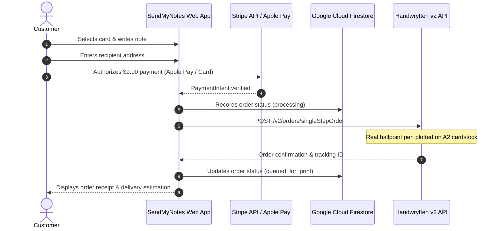

# Send My Notes

> **A thoughtful gesture made seamless. Your words, real pen and ink, mailed for you.**

## Start here: canonical project context

**Founder decisions established October 11, 2026.** All project participants
should read the [canonical project brief](docs/CANONICAL_PROJECT_BRIEF.md) and
[canonical product specifications](docs/CANONICAL_PRODUCT_SPECS.md) first.

- **Audience:** personal senders, 100%.
- **Value:** a thoughtful gesture made seamless. Customization contributes to
  thoughtfulness; stationery quality supports it.
- **Brand:** SendMyNotes serves the sender. Aster & Blanche is the recipient-facing
  stationery identity and landing page, with its small optional sending funnel.
  The intended redesign removes A&B from the SendMyNotes customer experience.
- **Baseline:** zero independent customer conversions. The one paid order was the
  founder's test. Apple Pay remains untested despite a successful Stripe payment.
- **Verified format:** Handwrytten A2 folded portrait, **4.25 × 5.5 inches**.
  Exact paper weight and complete supplier cost remain unconfirmed.
- **Photos:** authorized for marketing only after personal information is excluded
  or redacted and the exported asset is visually reviewed.

The [Handwrytten audit](docs/HANDWRYTTEN_INTEGRATION_AUDIT.md) records live catalog
verification and required alignment. For full architecture, state machines, and commerce engine details, see [ARCHITECTURE.md](ARCHITECTURE.md).

**Architecture & Technical Documentation:** [ARCHITECTURE.md](ARCHITECTURE.md)
contains the authoritative system overview, order lifecycle, Stripe/wallet integration,
environment secrets, and the "Clone & Carve" forking checklist.

[](https://nextjs.org/)
[](https://react.dev/)
[](https://www.typescriptlang.org/)
[](https://tailwindcss.com/)
[](https://stripe.com/)
[](https://www.handwrytten.com/)
[](https://firebase.google.com/)

---

## Overview

**Send My Notes** helps personal senders choose or create a card, write their own
message, and have it penned and mailed for them from their phone. Aster & Blanche
is the physical stationery identity. The experience aims to make sending quick
and effortless; the 60-second target has not been measured as a customer baseline.

Behind the scenes, the **Handwrytten API** selects an A2 folded portrait card and
submits the message for real-pen writing and postal fulfillment. See the canonical
specification sheet for confirmed dimensions, supplier timing guidance, and
remaining paper/envelope questions.

---

## Key Features

* **Live Card Preview:** On-screen visualization of the card and note. Exact physical geometry and wrapping require alignment with verified A2 specifications.
* **Natural Note Composer:** Unified single-field authoring (salutation, sentiment, closing, signature) with an instant smart shuffle across 11 occasions and 4 distinct tones.
* **Curated Calligraphy:** Defaults to authentic adult handwriting scale (**Casual David / `hwDavid`** at ~4mm letter height and ~8.5mm line spacing).
* **Atelier Colophon Backplate:** Custom architectural heritage press mark (Aster & Blanche Press, Lake Forest, IL) rendered at 300 DPI (`public/aster-blanche-backplate.png`, Handwrytten ID `751314`).
* **Guest Checkout:** Base $9.00 pricing including mailing, using Stripe. Apple Pay must be verified through the actual mobile purchase journey.
* **Zero-Spam Address Entry:** Clean inputs with standard HTML5 autofill (`shipping address-line1`, etc.) for 1-tap browser and Keychain autofill.

---

## Tech Stack

| Layer | Technologies |
| :--- | :--- |
| **Framework** | [Next.js 15](https://nextjs.org/) (App Router, Server Actions, Route Handlers) |
| **UI & Styling** | [React 19](https://react.dev/), [Tailwind CSS](https://tailwindcss.com/), [Lucide React](https://lucide.dev/) |
| **Payments** | [Stripe Elements](https://stripe.com/docs/elements) (Apple Pay, Google Pay, Credit Card) |
| **Fulfillment** | [Handwrytten API v2](https://www.handwrytten.com/api/) (`/v2/orders/singleStepOrder`) |
| **Database & Auth** | [Google Cloud Firestore](https://firebase.google.com/docs/firestore), Firebase Auth |
| **Image Pipeline** | [Sharp](https://sharp.pixelplumbing.com/) (300 DPI vector-to-raster cardstock generation) |
| **Hosting** | [Firebase App Hosting](https://firebase.google.com/docs/app-hosting) / Google Cloud Run |

---

## Security & Secrets Management

> **Industry Best Practice Notice:** Never commit secrets, private tokens, or live production keys to version control.

* All confidential keys (`STRIPE_SECRET_KEY`, `HANDWRYTTEN_API_KEY`, Firebase Admin credentials) remain strictly server-side.
* Only public identifiers (`NEXT_PUBLIC_STRIPE_PUBLISHABLE_KEY`, `NEXT_PUBLIC_APP_URL`) may be exposed to client bundles.
* In production, secrets are managed securely via **Google Cloud Secret Manager** and injected into Firebase App Hosting containers at runtime.

---

## Getting Started

### 1. Prerequisites
* **Node.js:** v20.x or higher
* **npm:** v10.x or higher
* Active accounts on **Stripe**, **Handwrytten**, and **Firebase**

### 2. Installation
```bash
git clone https://github.com/zbrustkern/sendmynotes.git
cd sendmynotes
npm install
```

### 3. Environment Configuration
Copy the template and configure your local development keys:
```bash
cp .env.example .env.local
```

Fill in your credentials in `.env.local`:
```env
# Stripe
STRIPE_SECRET_KEY=sk_test_...
STRIPE_WEBHOOK_SECRET=whsec_...
NEXT_PUBLIC_STRIPE_PUBLISHABLE_KEY=pk_test_...

# Handwrytten Fulfillment
HANDWRYTTEN_API_KEY=your_handwrytten_api_key
HANDWRYTTEN_TEST_MODE=true

# Firebase & App
FIREBASE_PROJECT_ID=your-project-id
NEXT_PUBLIC_APP_URL=http://localhost:3000
```

### 4. Running the Development Server
```bash
npm run dev
```
Open [http://localhost:3000](http://localhost:3000) in your browser.

---

## Available Scripts

| Command | Description |
| :--- | :--- |
| `npm run dev` | Starts the Next.js local development server with Hot Module Reloading |
| `npm run build` | Compiles the production build |
| `npm run start` | Boots the Next.js production server |
| `npm run lint` | Runs ESLint across the codebase |
| `npm run build:assets` | Compiles `assets/card-back.svg` into 300 DPI PNG backplate |
| `npm run build:previews` | Re-generates cover and card catalog thumbnail previews |
| `npm run test:m1` | Runs Milestone 1 integration tests |
| `npm run test:m4` | Runs Milestone 4 integration tests |

---

## Repository Structure

```
sendmynotes/
├── app/                  # Next.js App Router (pages, layout, route handlers)
│   ├── api/              # Fulfillment webhooks and Stripe endpoints
│   ├── checkout/         # Multi-step checkout & payment flows
│   └── page.tsx          # Storefront & card selection experience
├── assets/               # Master SVG vectors and design source assets
├── components/           # Reusable UI components
│   ├── AddressStep.tsx   # Native autofill recipient address form
│   ├── CardPreview.tsx   # 1:1 physical plotter preview simulation
│   └── InsideNoteStep.tsx# Single-field message composer & tone shuffle
├── context/              # React state providers (cart, session, flow)
├── lib/                  # Server-side clients & utilities
│   ├── firebase.ts       # Firestore & Admin SDK integration
│   ├── handwrytten.ts    # SingleStepOrder API client & font configs
│   └── stripe.ts         # Stripe payment intent helpers
├── public/               # Static web assets & 300 DPI print backplates
├── scripts/              # Asset compilers & image pipeline scripts
└── tests/                # Automated milestone & integration tests
```

---

## Order Fulfillment Flow



---

## License & Attribution

Copyright © Aster & Blanche Press / SendMyNotes. All rights reserved. Private repository.
