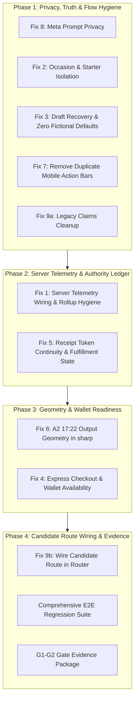

# SendMyNotes: Conversion Redesign Remediation Plan

**Document ID:** CR-PLAN-002  
**Date:** October 12, 2026  
**Status:** `APPROVED BY FOUNDER — Ready for Execution`  
**Governing Reviews:** [Independent Review of CR-VAL-001](CONVERSION_REDESIGN_VALIDATOR_STATUS_REPORT.md)  
**Target Branch:** `cr/integration`

### Approved Product Decisions (Confirmed October 12, 2026):
1. **Note Starters:** Clean, empty textarea on entry with a prominent 1-tap "Use suggested starter" chip tailored to the active card's occasion.
2. **Express Checkout Layout:** Dedicated top-mounted `ExpressCheckoutElement` (Apple Pay / Google Pay) button block separated by a clean "— Or pay with card —" divider above standard card fields.
3. **Route Cutover:** Candidate flow wired immediately behind the `isV3` candidate feature flag (accessible via `/new?v3=1` and homepage), keeping `/preview/entry` as the dedicated regression harness.

---

## 1. Executive Summary

The independent review of `CR-VAL-001` (commit `3a03508`) verified that the four foundational branches were successfully integrated, that the 4-step mobile purchase prototype connects end to end, and that all 12 test suites pass. However, the review identified **9 specific findings** where current code behavior must be corrected before production allocation.

This plan details the exact architectural corrections, file ownership, testing strategy, and sequencing required to resolve all 9 findings.



---

## 2. Remediation Plan by Finding

---

### Finding 1: Purchase Measurement & Rollup Authority (P1)
**Problem:** `recordServerTelemetry` is defined in `lib/metrics-rollup.ts:396` but only called in a test. The client still emits browser `payment_succeeded`, which is rejected with 403. The rollup still counts `inside_note_edited` as note completion (`:151`). Order revenue and paid counts (`:586`) do not exclude test, comp, or founder orders. `AddPaymentInfo` fires prematurely on step load (`app/preview/entry/client.tsx:483`).

**Corrections:**
1. **Wire Server Authority in Order Processor:** In `lib/order-processor.ts`, inside `processPaidOrder`:
   - Call `recordServerTelemetry` with event `purchase_verified` on payment verification.
   - Call `recordServerTelemetry` with event `fulfillment_submitted` on successful Handwrytten API dispatch.
   - Call `recordServerTelemetry` with event `fulfillment_failed` on supplier dispatch error.
2. **Purge Browser Authority Call:** In `app/preview/entry/client.tsx`, remove the client `trackEvent("payment_succeeded", ...)` call; confirmation step relies on server verification.
3. **Correct Note Completion Rollup Semantics:** In `lib/metrics-rollup.ts`, remove `inside_note_edited` from the `noteCompleted` funnel increment. Only `event.eventName === "note_completed"` increments the unique session funnel.
4. **Exclude Test / Comp / Founder Orders:** In `computeBusinessMetricsSummary` (`lib/metrics-rollup.ts:586`), strictly filter out orders where `o.isTest === true`, `o.isComp === true`, `o.isMock === true`, or `o.id === FOUNDER_TEST_ORDER_ID` from customer paid count and revenue totals.
5. **Remove Premature `AddPaymentInfo`:** In `app/preview/entry/client.tsx`, remove `trackMetaAddPaymentInfo` and `trackGA4AddPaymentInfo` from step navigation (`handleStepTransition('pay')`). Only emit `AddPaymentInfo` when the customer actually interacts with payment inputs or clicks Submit.

---

### Finding 2: Selected Occasion & Message Starter Isolation (P1)
**Problem:** `currentCard.occasion` falls back to the URL occasion or first preset's occasion rather than the selected preset (`app/preview/entry/client.tsx:180`). Continuing to note auto-inserts the first preset's default birthday message (`:358`), so selecting a sympathy card on a generic URL injects birthday text.

**Corrections:**
1. **Derive Occasion Directly from Card Selection:**
   - When a preset is selected, use `preset.occasion`.
   - When custom art is generated, use `art.occasion` from the generator drawer.
   - Update `currentCard.occasion` in `app/preview/entry/client.tsx` to resolve: `draft.selectedDesign?.occasion || selectedPreset?.occasion || occasionParam || "Just Because"`.
2. **Explicit Starter Insertion:**
   - Do not auto-inject default text into an empty note editor upon advancing.
   - Start the textarea empty, but display a prominent, 1-tap **"Use suggested starter"** button tailored to the *actual* resolved occasion (e.g. Sympathy, Thank You, Birthday).
   - If the user taps "Use suggested starter", it fills the textarea, marked as undoable.

---

### Finding 3: Full Draft Recovery & Zero Fabricated Defaults (P1)
**Problem:** Greeting and sign-off initialize to "Dear Eleanor," and "Warmly, Thomas" (`app/preview/entry/client.tsx:74`), while recipient and sender state initialize to fictional "Eleanor Vance" and "Thomas Miller" (`:79`, `:88`). These fabricated names get sent to the supplier if unedited (`:402`), and refresh resets greeting/sign-off.

**Corrections:**
1. **Purge All Fabricated Values:**
   - Initialize `recipient` and `sender` fields to empty strings `""`.
   - Display placeholder guidance only via HTML `placeholder` attributes (e.g., `placeholder="e.g. Eleanor Vance"`).
   - Form validation requires user-entered names before advancing to pay.
2. **Extend `NoteDraft` Schema:**
   - Update `lib/draft/types.ts` to include message parts:
     ```typescript
     export interface NoteDraft {
       salutation: string;
       text: string;
       signOff: string;
       style: string;
     }
     ```
   - Persist `salutation`, `text`, `signOff`, and `style` together in `sessionStorage`.
   - On page refresh, fully restore all three text fields.
3. **Safe Post-Payment Recovery:**
   - Once payment is verified, mark the draft as `completed: true`. If the user refreshes on the confirmation screen, do not present a re-submittable checkout draft.

---

### Finding 4: Express Checkout Wallet Integration & Fallback (P1)
**Problem:** `Step4ReviewAndPayment` mounts `PaymentElement`, not `ExpressCheckoutElement`. Dedicated wallet availability is not observed or logged.

**Corrections:**
1. **Mount Express Checkout Button Block:**
   - In `components/v3/Step4ReviewAndPayment.tsx`, add `<ExpressCheckoutElement />` above the standard payment inputs.
   - When wallets are available (Apple Pay / Google Pay), render the 1-tap express button, followed by a clean visual divider (`— Or pay with card —`).
2. **Track Wallet Availability Telemetry:**
   - Hook into the Express Checkout `onReady` event.
   - Emit `wallet_availability_observed` to telemetry with `applePay: boolean`, `googlePay: boolean`, and browser category.
3. **Keep Real-Device Apple Pay Gated:**
   - Document in release notes and gate reports that Apple Pay is unverified until an Operator (`OP`) completes a real transaction test on an iOS device.

---

### Finding 5: Receipt Continuity & Server-Verified Fulfillment State (P1)
**Problem:** `create-intent` returns `viewToken`, but the client does not store or pass it. Payment confirmation calls `confirm-order` without checking its HTTP status code before declaring success (`Step4ReviewAndPayment.tsx:259`). Confirmation statically displays "In Production" (`Step5Confirmation.tsx:217`).

**Corrections:**
1. **Preserve `viewToken` in Session State:**
   - Store `viewToken` in ephemeral React state (never persisted to unauthenticated localStorage).
   - Pass `viewToken` into the order URL (`/order/${orderId}?viewToken=${viewToken}`) so guest users can safely view and track their receipt.
2. **Inspect `confirm-order` Result:**
   - In `Step4ReviewAndPayment.tsx`, inspect `confirmRes.ok` and the returned payload.
   - Distinguish `PAYMENT_RECEIVED`, `PROCESSING_HANDWRYTTEN`, and `FULFILLMENT_FAILED`.
3. **Dynamic Fulfillment Confirmation:**
   - In `components/v3/Step5Confirmation.tsx`, display status dynamically based on server response (e.g., "Payment Confirmed • Queued for Pen Inking"). If fulfillment encounters a temporary supplier delay, display "Payment Received • Preparing for Inking" with support contact, rather than a false static claim.

---

### Finding 6: Output Alignment to A2 17:22 Geometry (P1)
**Problem:** `lib/image-optimizer.ts:27` resizes uploaded images to 1500 × 2100 (5:7 ratio), and `components/CardPreview.tsx:169` uses 5:7.

**Corrections:**
1. **Update Sharp Optimizer to True Folded A2 (17:22):**
   - Folded A2 dimensions are 4.25 × 5.5 inches.
   - At 300 DPI, target pixel dimensions are **1275 × 1650 pixels** (aspect ratio 17:22 = 0.7727).
   - Update `lib/image-optimizer.ts` to resize to `1275 × 1650` with high-quality mozjpeg compression, well under Firestore's 1MB limit.
2. **Align Preview Geometry:**
   - Update `components/CardPreview.tsx` container aspect ratio from `aspect-[5/7]` to `aspect-[17/22]`.
   - Ensure artwork cropping respects the folded front safe area without stretching.

---

### Finding 7: Remove Duplicate Mobile Action Bars (P2)
**Problem:** Reused sub-components `Step2NoteComposition.tsx` (line 528) and `Step3EnvelopeAddressing.tsx` (line 487) have built-in `fixed bottom-0 z-40` action bars that render simultaneously with `ActionBar.tsx` on mobile.

**Corrections:**
1. **Add `hideFixedActionBar` Prop:**
   - Add optional `hideFixedActionBar?: boolean` prop to `Step2NoteComposition` and `Step3EnvelopeAddressing`.
   - When set to `true`, suppress the internal fixed bottom bars in those components.
2. **Centralize Mobile Navigation:**
   - In `app/preview/entry/client.tsx`, pass `hideFixedActionBar={true}` so that only the parent `components/flow/ActionBar.tsx` controls the fixed bottom dock.

---

### Finding 8: Eliminate Customer Prompt PII from Meta Pixel (P1)
**Problem:** `app/preview/entry/client.tsx:232` passes `art.prompt.slice(0, 30)` as `contentName` to Meta Pixel. Prompts can contain sensitive names or personal details.

**Corrections:**
1. **Static Content Label:**
   - In `app/preview/entry/client.tsx`, update `handleSelectCustomCover`:
     ```typescript
     trackMetaCustomizeProduct({
       customizationType: "AI Art Generated",
       occasion: art.occasion || "Personal Note",
       contentName: "Custom Artwork Card",
     });
     ```
   - Never transmit the customer prompt string in any client-side or server-side marketing telemetry payload.

---

### Finding 9: Route Wiring & Truth Claims Cleanup (P1)
**Problem:** The candidate flow is not yet mounted at `/new` or `ExperienceRouter.tsx`. Legacy files still contain obsolete claims (`VendingMachineBuilder.tsx:648` says 120 lb stock and mailing today; `CheckoutStep.tsx:428` says 5×7).

**Corrections:**
1. **Legacy Claims Neutralization:**
   - Update `components/VendingMachineBuilder.tsx`: Replace "120 lb archival cardstock" with "quality cardstock", replace "today" with estimated transit guidance, remove "Aster & Blanche Press • Lake Forest, IL" from sender header.
   - Update `components/CheckoutStep.tsx`: Replace "5×7 Heavy Cardstock" with "Folded A2 Cardstock".
2. **Wire Candidate Router:**
   - Update `components/ExperienceRouter.tsx` to render `EntryPrototypeClient` when candidate mode is active (`isV3 === true` or feature flag on).
   - Update `app/new/page.tsx` to mount `EntryPrototypeClient` directly.

---

## 3. Testing & Verification Suite

We will create a dedicated test suite `tests/review-remediation.test.ts` covering:

| Test Case | Verification Condition |
| :--- | :--- |
| **Occasion Isolation** | Selecting a sympathy preset on a generic landing keeps occasion as "Sympathy & Support" and does NOT insert birthday text. |
| **Zero Fictional Defaults** | Fresh session initializes all name inputs to `""`. Dispatch payload with empty names is blocked. |
| **Full Draft Recovery** | Refreshing with customized `salutation`, `text`, `signOff`, and addresses recovers 100% of values. |
| **Server Telemetry Call** | `processPaidOrder` emits `purchase_verified` via `recordServerTelemetry`; rejected browser events do not increment paid counts. |
| **Rollup Filter** | Comp/test/founder orders are excluded from total revenue and paid customer counts. |
| **Rollup Step Semantics** | `inside_note_edited` alone does not increment `noteCompleted`. |
| **Prompt PII Protection** | Meta Pixel payload for custom art contains static label `"Custom Artwork Card"`; prompt text is never transmitted. |
| **A2 Dimensions** | `optimizeCoverImage` outputs 1275 × 1650 pixels (17:22 ratio). |

---

## 4. Execution Sequence

| Phase | Tasks | Est. Time | Gate / Deliverable |
| :---: | :--- | :---: | :--- |
| **1** | Privacy, Occasion & Draft Fixes (Findings 2, 3, 7, 8, 9a) | Immediate | All inputs clean of fictional names; Meta privacy clean. |
| **2** | Server Telemetry & Rollup Authority (Finding 1) | Immediate | Server telemetry wired to order processing; test orders excluded. |
| **3** | Receipt State, Wallet & A2 Geometry (Findings 4, 5, 6) | Follow-up | Express Checkout button mounted; Sharp outputs 1275×1650. |
| **4** | Route Wiring & E2E Verification (Finding 9b) | Follow-up | Router wired; `npm test` and `npm run build` pass. |
