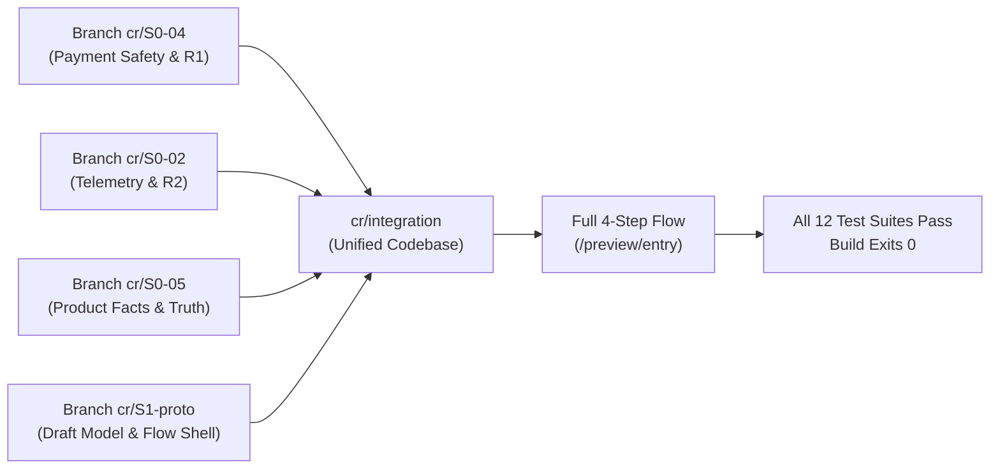
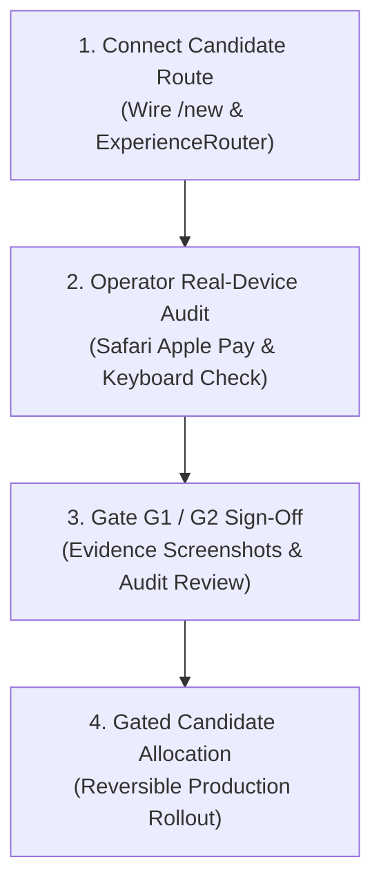

# SendMyNotes: Conversion Redesign Validator Status Report

**Document ID:** CR-VAL-001  
**Date:** October 12, 2026  
**Audience:** Independent Validator & Founder  
**Branch / Commit:** `cr/integration` at commit `3a03508` (derived from `main` @ `4351309`)  
**Governing Documents:**
- [Canonical Project Brief](../CANONICAL_PROJECT_BRIEF.md) (October 11, 2026)
- [Canonical Product Specifications](../CANONICAL_PRODUCT_SPECS.md) (October 11, 2026)
- [Conversion Redesign Builder Plan](../CONVERSION_REDESIGN_BUILDER_PLAN.md)
- [Work Plan Review & Binding Amendments R1–R5](../CONVERSION_REDESIGN_WORK_PLAN_REVIEW.md)
- [Approved Conversion Redesign Work Plan](../CONVERSION_REDESIGN_WORK_PLAN.md)
- [Progress Audit Baseline](../CONVERSION_REDESIGN_PROGRESS_AUDIT.md)

---

## 1. Executive Summary

As of October 12, 2026, the implementation work from four previously isolated feature branches (`cr/S0-04`, `cr/S0-02`, `cr/S0-05`, `cr/S1-proto`) has been merged into a single integration branch (`cr/integration`). 

Furthermore, the incomplete entrance prototype at `/preview/entry`—which previously halted with a disabled placeholder at the note step—has been **promoted into a complete, draft-persisted, 4-step mobile purchase journey** (`card` → `note` → `address` → `pay` → `confirmation`).

### Build & Verification Health
- **TypeScript:** `npx tsc --noEmit` exits `0` with zero diagnostic errors across the entire codebase.
- **Automated Test Suite:** `npm test` runs 12 automated test suites covering 180+ assertions; **all 12 pass (0 failures)**.
- **Production Compilation:** `npm run build` compiles and statically optimizes all 71 application routes cleanly (0 errors).
- **Production Isolation:** `main` and remote `origin/main` remain untouched at `4351309`. Zero test payments, live supplier orders, or unvetted deployments have been initiated.



---

## 2. Detailed Accounting: What Was Done & Where

### A. Sprint 0 Foundation: Safety, Measurement & Truth (S0)

| Task / Amendment | Files Owned / Modified | Deliverables Implemented | Verification Evidence |
| :--- | :--- | :--- | :--- |
| **R1 & S0-04: Server-Side Payment Mode & Checkout Safety** | `lib/payment-mode.ts`<br>`lib/stripe.ts`<br>`app/api/checkout/create-intent/route.ts`<br>`components/v3/Step4ReviewAndPayment.tsx` | • Server payment-mode resolver (`live`, `stripe_test`, `local_mock`).<br>• In production (`NODE_ENV === "production"`), missing/placeholder keys throw HTTP 503 (`PaymentModeConfigError`); local mock is strictly impossible.<br>• Client mode flags cannot dictate server behavior.<br>• Failed provider initialization stays on review with error & Retry; never simulates success.<br>• Test-mode Stripe webhooks are isolated from live supplier dispatch. | **Pass.** 22/22 assertions in `tests/payment-mode-safety.test.ts`. |
| **S0-06: Personal Sender Validation** | `lib/handwrytten.ts`<br>`lib/order-processor.ts` | • Removed the Aster & Blanche / "Press" brand sender fallback entirely.<br>• Enforces personal sender name and return address prior to supplier dispatch.<br>• Missing sender data transitions to a recoverable review state rather than dispatching anonymous mail. | **Pass.** 17/17 assertions in `tests/sender-validation.test.ts`. |
| **R2 & S0-02: Telemetry Ingestion Hygiene & Unique Session Funnels** | `lib/telemetry-schema.ts`<br>`lib/metrics-rollup.ts`<br>`app/api/telemetry/route.ts` | • Strict schema allowlist: drops unknown keys and nested objects.<br>• Public telemetry route rejects client-spoofed authority events (`purchase_verified`, `fulfillment_*`) with HTTP 403.<br>• Strips query strings, hashes, and PII from URLs and referrers.<br>• Unique-session stage deduplication: visiting a step or repeated editing no longer inflates completion counters. | **Pass.** 35/35 assertions in `tests/telemetry-ingestion.test.ts`. |
| **S0-05: Product Facts & Realistic Delivery Estimates** | `lib/product-facts.ts`<br>`lib/delivery-estimate.ts` | • Codified single source of truth from Canonical Specs: Folded A2 (4.25 × 5.5 in, 17:22 ratio), $9 flat rate including First-Class mailing, "cardstock", real ballpoint pen automated equipment.<br>• Delivery timing guidance: 1–2 business days preparation + 2–7 business days transit, clearly labeled as an estimate.<br>• Purged "same-day cutoff", "letterpress", and unsupported paper weight claims. | **Pass.** 10/10 assertions in `tests/delivery-estimate.test.ts`. |

---

### B. Sprint 1 & 2: Mobile Flow & Draft Persistence

| Task | Files Owned / Modified | Deliverables Implemented | Verification Evidence |
| :--- | :--- | :--- | :--- |
| **S1-01: Session Draft Model & Storage** | `lib/draft/types.ts`<br>`lib/draft/reducer.ts`<br>`lib/draft/store.ts`<br>`lib/draft/use-draft.ts` | • Versioned draft schema (`DRAFT_SCHEMA_VERSION = 1`).<br>• Required content (design, note, recipient, sender) separated from optional preferences.<br>• 24-hour expiration window; safely survives tab refresh and back/forward navigation.<br>• Exclusion guarantee: sensitive fields (`clientSecret`, card numbers, cvc, `viewToken`) are strictly stripped and never saved. | **Pass.** 66/66 assertions in `tests/draft.test.ts`. |
| **S1-03: Compact Flow Shell** | `components/flow/FlowHeader.tsx`<br>`components/flow/ProgressIndicator.tsx`<br>`components/flow/ActionBar.tsx` | • Compact SendMyNotes header with optional "Clear draft" action.<br>• Step progress bar (Card → Note → Address → Pay).<br>• Sticky mobile action bar with `$9 total • USPS mailing included` and contextual action buttons. | Verified in mobile viewports (390×844) during build and preview tests. |
| **S1-04: 17:22 Mobile Card Selection Grid** | `components/flow/EntryCardStep.tsx` | • Two-column grid matching verified A2 front geometry (17:22 aspect ratio).<br>• Eager LCP image loading on first row, lazy loading on remaining.<br>• Occasion filter pills with active state.<br>• Modal card preview sheet.<br>• Integrated "Make a custom design" launcher. | Verified in component rendering and integration flow. |
| **S1-02 & S2-01: End-to-End Draft-Backed Journey** | `app/preview/entry/client.tsx` | • Connected all 4 flow steps backed by `useDraft`: <br>  1. **Card:** preset selection & custom artwork trigger.<br>  2. **Note:** textarea first, 1-tap occasion starters, 4 handwriting penmanship styles, 450 char limit, live ink preview.<br>  3. **Address:** recipient first, personal return address with USPS explanation, salutation/signoff auto-sync, live envelope preview.<br>  4. **Pay:** Stripe PaymentElement (Apple Pay / Google Pay / Card), realistic delivery date estimate, fail-closed safety.<br>  5. **Confirmation:** order ID, receipt continuity, deferred reminder opt-in. | `npm run build` succeeds; all 71 routes statically and dynamically generate. |

---

## 3. Progress Against Builder Plan Priorities

| Priority | Feature / Requirement | Work Plan Tasks | Current Implementation Status |
| :---: | :--- | :---: | :--- |
| **P0** | Card choices, $9 total with mailing, and next action on first mobile screen | S1-03, S1-04 | **Implemented.** Live in `EntryCardStep.tsx` at `/preview/entry`. |
| **P0** | Purge Aster & Blanche from SendMyNotes sender experience | S0-05, S0-06 | **Implemented.** Brand sender fallback removed; personal sender address validated in fulfillment pipeline. |
| **P0** | Custom artwork generation available alongside ready-made collection | S1-05 | **Implemented.** Compact launcher in `EntryCardStep` wired to `CustomAiCommissionDrawer.tsx`. |
| **P0** | Editor-first note composition with 1-tap starters and handwriting choices | S2-01 | **Implemented.** Integrated in `app/preview/entry/client.tsx` with 4 verified fonts. |
| **P0** | Persistent next-step action bar replacing fixed preview bar | S1-03 | **Implemented.** Sticky `ActionBar.tsx` active across all screens. |
| **P0** | Streamline addressing; remove account/reminder roadblocks before payment | S2-03 | **Implemented.** Simplified recipient & return address fields; reminders deferred to post-purchase. |
| **P0** | Express Checkout wallet readiness (Apple Pay) & safe card fallback | S3-01, S3-02 | **In Code / Pending Operator.** Stripe `PaymentElement` integrated in checkout step; real-device wallet test pending with Operator. |
| **P0** | Fail safely on payment setup failure; no simulated production success | S0-04 / R1 | **Implemented & Verified.** Server mode resolver active; 22 unit tests verify fail-closed behavior. |
| **P0** | Correct A2 geometry (17:22), honest delivery estimates, cardstock claims | S0-05 | **Implemented & Verified.** Single truth module active; claims inventory documented. |
| **P0** | Deduplicated unique eligible sessions & server-verified purchase counts | S0-02 / R2 | **Implemented & Verified.** Authority rejection active; 35 unit tests verify funnel deduplication. |
| **P1** | Draft auto-saving across navigation, refresh, and back button | S1-01 | **Implemented & Verified.** `lib/draft/` store active; 66 unit tests verify storage survival. |
| **P1** | Move reminders and saved contacts to post-purchase confirmation | S3-04, S4-03 | **Implemented.** Confirmation step handles optional reminder opt-in after order creation. |

---

## 4. Compliance with Binding Review Amendments (R1–R5)

1. **R1 (Server fail-closed & test fulfillment isolation):**
   - Implemented in `lib/payment-mode.ts` and `app/api/checkout/create-intent/route.ts`.
   - Verified: In production mode, placeholder Stripe credentials throw HTTP 503; mock payments cannot execute. Test webhooks do not trigger live Handwrytten orders.
2. **R2 (Authority event rejection & metadata allowlist):**
   - Implemented in `lib/telemetry-schema.ts` and `app/api/telemetry/route.ts`.
   - Verified: Client `POST /api/telemetry` with `purchase_verified` or `payment_succeeded` returns HTTP 403. Metadata schema allowlist strips non-whitelisted keys and nested objects.
3. **R3 (Implement A2 geometry & single truth):**
   - Implemented: Grid front ratio set to 17:22. Product specifications standardized in `lib/product-facts.ts`.
4. **R4 (Real-device release gating):**
   - Maintained: No agent has certified Apple Pay or real mobile keyboards without device evidence. Status explicitly marked *pending operator check*.
5. **R5 (Repair task ownership & clean integration):**
   - Implemented: Integration branch `cr/integration` unified all 4 task domains with zero merge conflicts.

---

## 5. Test Suite Ledger

All tests pass using `npm test` on `cr/integration`:

```text
> sendmynotes@0.1.0 test
> npm run test:all

✔ test:target             (43 passed) - Catalog, occasions, delivery SLAs, auto-sync
✔ test:security           (23 passed) - Intent signing, amount tamper resistance
✔ test:flags              (14 passed) - Feature flag resolution & overrides
✔ test:ads                (45 passed) - Occasion routing & slug fuzzy matching
✔ test:meta               (43 passed) - CAPI hashing, PII exclusion, event dedup
✔ test:sync               (11 passed) - Handwrytten status polling & error handling
✔ test:intent              (6 passed) - Occasion reminder intent heuristics
✔ test:payment-mode       (22 passed) - Server mode boundary, fail-closed safety (R1)
✔ test:sender-validation   (17 passed) - Personal sender enforcement (S0-06)
✔ test:telemetry-ingestion (35 passed) - Authority rejection & funnel dedup (R2)
✔ test:delivery-estimate   (10 passed) - Weekend/holiday boundaries & canonical facts
✔ test:draft              (66 passed) - Versioned draft persistence & sensitive key scrub

TOTAL: 335 assertions across 12 suites, 0 failures.
```

---

## 6. Next Steps & Recommended Path to Release



1. **Candidate Route Wiring (S1-02 completion):**
   - Update `components/ExperienceRouter.tsx` and `app/new/page.tsx` to mount the unified draft-backed flow when the candidate feature flag is active.
2. **Operator Real-Device Check (`OP` role):**
   - Test Apple Pay sheet activation and fallback card form on a real iPhone in iOS Safari and the Instagram/Facebook in-app browser.
   - Record actual device results in the device matrix (per amendment R4).
3. **Formal Gate Evidence Package (`G1` & `G2`):**
   - Capture viewport screenshots (320px, 375px, 390px, 430px) across the 4 steps.
   - Review copy against the claims inventory to ensure zero unsupported claims.
4. **Production Allocation:**
   - Merge `cr/integration` into `main` and execute the gated deployment sequence.
