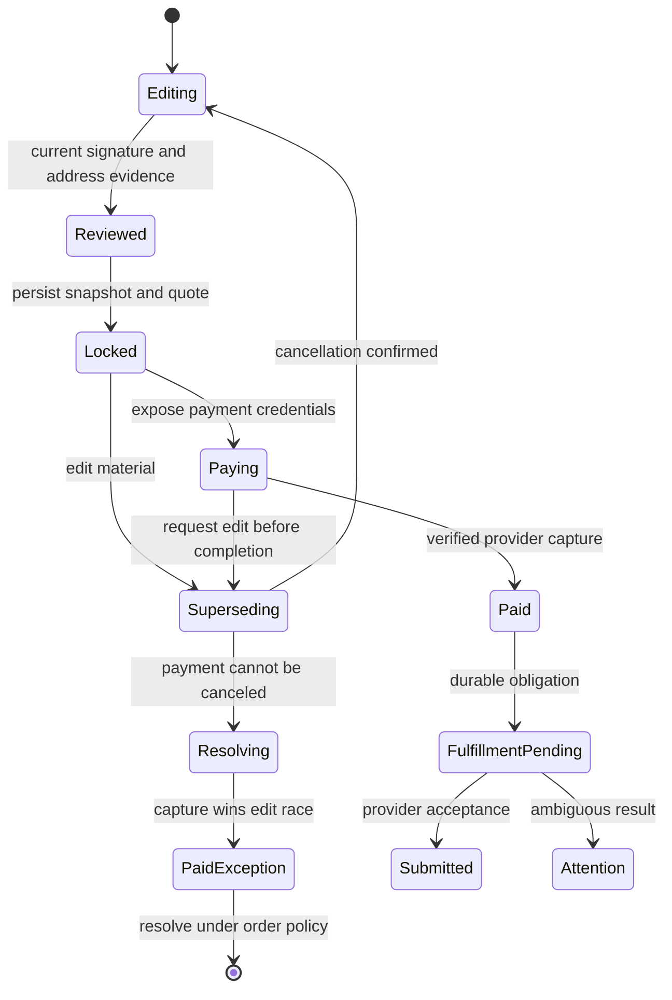

# DocketStamp robustness and business growth design outline

**Date:** October 26, 2026 · **Status:** Proposed design

The strongest lesson from SendMyNotes is to preserve the customer's work and bind every irreversible action to exactly what they reviewed. DocketStamp should build on its existing commerce safeguards, close the gaps between checkout and operational recovery, and make the resulting experience easier to complete and operate. Business growth should follow measured customer payments, successful fulfillment, and contribution after acquisition costs.

This outline evaluates the [submitted lessons](DOCKETSTAMP_LESSONS_FROM_SENDMYNOTES.md), incorporates additional SendMyNotes findings, and proposes an integration sequence. [CHAPTER-0001](chapters/CHAPTER-0001-reliable-commerce-and-customer-continuity.md) captures the durable direction for future sprint planning. This is a design proposal; implementation status remains in the existing sprint ledgers.

## Authority and scope

The [Master Build Specification](DOCKETSTAMP_MASTER_BUILD_SPEC.md), [Agentic Expansion Specification](DOCKETSTAMP_AGENTIC_EXPANSION.md), their scoped authority updates, and [AGENTS.md](../AGENTS.md) remain binding. Preserve all six invariants: the hard NAICS 713940 exclusion with permitted hardware OEMs; deterministic self-help preparation and mandatory UPL/statutory disclosures; one-page Letter geometry and postal clear zones; shared interpolation for preview and print; immutable snapshots persisted before payment credentials; and isolated verification/dispatch keys with staging simulation.

Preserve current template governance: human-controlled availability, content digest/review records, explicit residence/property declarations, and transactional policy checks for new stages and locks. A subsequent availability change does not invalidate an already-committed lock. Customer-requested checkout supersession is a separate lifecycle decision.

Evolve the [approved purchase journey](DOCKETSTAMP_HOME_CONVERSION_DESIGN_SPEC.md). Keep one chooser and one workspace, direct campaign/company/agent entry, optional accounts, and guest checkout. This outline introduces neither new letter categories nor new statutory prose, prices, international dispatch, or multi-page documents.

## Evaluation of the eight lessons

| Lesson | Assessment | Integration decision |
| --- | --- | --- |
| Freeze invalidation | Essential, but clearing client state cannot revoke a Stripe secret or undo a successful payment. | Add a server-owned checkout-attempt lifecycle and explicit cancellation-race handling. Preserve old snapshot bytes and financial evidence. |
| Readable admin metrics | Strong direction. Observed activity, verified money, and estimated costs answer different questions. | Show useful available numbers with compact source/freshness indicators; retain unknown and incomplete states when data is actually missing. |
| Branch discipline | Strong lesson; permanent mandatory cherry-picking would create another divergence problem. | Use short branches, reviewed candidates and exact deployment SHAs. Reserve cherry-picking for scoped recovery from current divergence. |
| Preview fidelity | Essential. Shared text interpolation alone does not establish physical layout parity. | Share physical geometry/typography and compare rendered output against provider proofs. Scale the page for the screen without reflowing print layout. |
| History and recovery | Essential. `sessionStorage` supports reload recovery but cannot promise durable recovery after tab closure. | Synchronize workflow navigation, retain tab-scoped drafts, and make cross-session save an explicit separate capability. |
| Address assistance | Strong hypothesis. ZIP suggestions, CASS results, deliverability, and the correct notice destination must remain distinct. | Add revision-bound server verification with actionable inline corrections. Keep operator exceptions outside ordinary customer checkout. |
| Privacy | Foundational. An allowlisted key can still contain sensitive values; template identity can itself reveal a sensitive interest. | Extend existing typed telemetry and consent controls, minimize third-party fields, and protect prefills, stage links, logs, and receipt access. |
| Server pricing | Already substantially implemented. The supplied price examples and multi-page surcharge do not apply. | Continue using the authoritative registry: $12.95 / $19.95 / $27.95. Bind discounts, tier, currency and total to each immutable quote; reject overflow. |

The cited 63% abandonment is **not an established DocketStamp baseline**. The SendMyNotes catch-up document presents a sample funnel whose checkout transition actually has a larger percentage loss. Establish dated cohorts and denominators before assigning conversion impact. Its 368-file divergence has stronger support in SendMyNotes SPRINT-0019: 136 application files, with substantial documentation and evidence among the remaining files. File count is a release-complexity signal, not a feature count.

## Current foundations and integration gaps

These are observations from the local source; they identify implementation surfaces without asserting deployed behavior.

| Surface | Existing foundation | Gap to close |
| --- | --- | --- |
| Workspace and checkout | [DocumentWorkspace](../src/components/docket/DocumentWorkspace.tsx) preserves drafts and invalidates signatures after edits. [CheckoutModal](../src/components/docket/CheckoutModal.tsx) fingerprints inputs, clears stale local locks, and creates fresh docket IDs. | The inspected flow has no workflow history synchronization or server supersession protocol. Async lock responses need an explicit current-revision check. |
| Lock and payment authority | [lock-and-intent](../app/api/docket/lock-and-intent/route.ts) persists frozen HTML under policy before payment credentials. [Financial authority](../lib/admin-console/finance/authority.ts) checks provider payment evidence, amount, order association, mode and snapshot binding, and creates durable obligations. | Persist checkout attempt/revision and quote identity. Derive account ownership only from verified authentication: the lock route currently initializes ownership from body `userId` before attempting token verification. |
| Postal fulfillment | [Dispatch attempts](../lib/admin-console/postal/attempt-store.ts) and [authorized dispatch](../lib/admin-console/postal/dispatch.ts) support leases, snapshot binding and uncertain outcomes. | Normal paid `consumePaymentObligation()` still calls [processPaidOrder](../lib/order-processor.ts). Converge the entry points before claiming a single dispatch implementation. |
| Address intake | [PostalAddressFields](../src/components/docket/PostalAddressFields.tsx) has stale-response-safe ZIP assistance; [verify-address](../app/api/docket/verify-address/route.ts) exposes the Lob adapter. | The inspected workspace/checkout do not call that endpoint, and lock input validation checks address structure without consuming durable CASS evidence. Wire the complete path. |
| Preview | Preview and print consume [interpolateNotice](../src/lib/docket/renderer/interpolate.ts). | [LivePaperSheet](../src/components/docket/LivePaperSheet.tsx) uses responsive flex layout/padding while the [Lob shell](../src/lib/docket/renderer/lob-html-shell.ts) uses absolute inch geometry. Equal content is not yet evidence of equal line wrapping. |
| Measurement and reporting | [Telemetry schemas](../lib/telemetry-schema.ts), browser authority-event rejection, typed business events, payment facts and published report generations already exist. | [Report preparation](../lib/admin-console/reporting/store.ts) scans environment-scoped collections up to a 10,000-row cap before computing scope. Push appropriate time predicates into source queries while preserving historical joins and reconciliation. |

## Proposed customer experience

Keep the progression **Details → Review and sign → Delivery → Payment → Order status** within the current workspace/modal architecture. Make the current step and one useful Back action visible. Browser Back/Forward should follow meaningful transitions, restore focus and preserve compatible values. At the first workflow step, normal browser departure remains possible.

For example, a sender spots an apartment typo at payment, returns to Details, corrects it, accepts the postal suggestion, reviews the revised letter and pays the new server-confirmed amount. The previous snapshot remains in the audit record. The old attempt cannot silently become the revised order. If payment was already processing, the interface resolves that payment before offering another charge.

Browsing a company, reading an example or exploring another template must not overwrite the active letter. Treat a candidate selection separately from an explicit commit, preserve compatible values, and explain which incompatible values would be cleared. Keep example data isolated from real drafts. Late agent hydration, ZIP/CASS replies and lock responses must not overwrite newer user choices.

### Navigation and recovery

Use the Next.js routing/history integration appropriate to the mounted flow. Establish the initial entry with replacement, push meaningful forward transitions, and handle traversal without pushing another entry. URL steps are navigation hints: a direct `step=payment` URL must still pass current draft, signature, availability and quote gates. Keep document data and payment secrets out of history state.

Extend the existing versioned, tab-scoped [draft recovery](../src/lib/docket/draft-recovery.ts). Scope recovery by letter and account context; honor explicit stage/prefill precedence; clear drafts on reset, successful handoff and account changes as appropriate. Recover inputs without restoring signature consent or verification as current authority. Storage failures should leave the current in-memory draft usable.

Offer cross-session saving only as a later, explicit capability with durable storage, expiration, access control and deletion. Tab closure ends the ordinary `sessionStorage` session; it is not a reliable save-later mechanism. [MDN sessionStorage documentation](https://developer.mozilla.org/en-US/docs/Web/API/Window/sessionStorage).

### Address review

Keep rental property, sender mailing address and recipient destination visibly separate. ZIP assistance may suggest city/state, but never earns a verified badge. Use a server result tied to an exact address digest, provider mode and verification timestamp. Address changes invalidate it; stale responses are ignored.

When normalization changes an address, show the entered and suggested versions and an explicit acceptance action. Distinguish missing apartment/unit, undeliverable result, temporary verifier outage and rate limit, with a useful correction/retry path. Never silently substitute unit designators or infer residence eligibility from an address.

Before a new lock, the server verifies matching evidence or performs verification. A newly accepted normalization returns the user to review before freezing. Staging results say simulated. If exceptions are eventually supported, require an authorized operator, recorded reason and provider-compatible dispatch policy; a customer checkbox cannot bypass verification or the fitness blocker. Registry entries also need source, purpose and review dates: postal normalization does not prove that a corporate office is the required destination for a particular agreement.

## Checkout integrity design

Introduce a small server-owned checkout-attempt record around the existing frozen order. Proposed fields include `attemptId`, opaque `draftId`, `draftRevision`, `orderId`, `snapshotHash`, `quoteVersion`, `pricingVersion`, amount/currency/tier, policy evidence, `paymentIntentId`, lifecycle state and `supersededBy`. Continue storing exact HTML and signature evidence in the existing order schema; do not rewrite historical hash formats.

Separate lifecycle metadata from immutable document material. Retries with the same request identity return the same attempt; deliberately changed material produces a new attempt. Bind request identity to a server-validated ownership/capability scope and payload digest, so a key cannot be replayed with different values. Snapshot contents and total remain authoritative on the server.

Navigation alone does not destroy an otherwise valid lock. A material content/address/tier/discount change starts server supersession and invalidates the relevant review. For tier changes, preserve typed inputs and refresh the visible document/service/total before reconfirmation. A delayed lock response carries its originating revision; discard it when that revision is obsolete, and reconcile any server-created attempt.

Supersession must disable the old payment controls immediately, then durably request cancellation and verify the provider result. Stripe cancellation is available only in specified states; a successful payment cannot be made unpaid by clearing local state. Block a replacement payment while an old attempt is processing or its outcome is unknown. [Stripe cancellation reference](https://docs.stripe.com/api/payment_intents/cancel).

If capture wins a cancellation race, record the real payment and its original snapshot, place the attempt in an explicit exception state before fulfillment when possible, and resolve it under the order/refund policy. Never dispatch the new draft using the old payment, discard a captured-payment event, or promise a refund before recording it. An order already submitted to the supplier retains its actual state and follows the applicable support process. Signature and postal evidence cannot be silently transferred to edited material.

Verify these boundaries through the server confirmation endpoint, webhook, free-order completion and operator commands. Account ownership comes only from verified identity; guests retain scoped opaque access capabilities. Cancellation/supersession commands must have the same authorization protection as viewing or paying for the attempt.

## Fulfillment and recovery design

Use existing financial facts and durable obligations, then converge paid/free/comp/operator recovery through the authorized postal dispatcher. Preserve current guards during migration; migrate one entry point at a time with evidence that the old path cannot also submit the same order.

Keep payment, fulfillment and postal progression distinct: **Payment received → Preparing mailing → Submitted to mail provider → Postal event reported**, with **Needs attention** when required. Supplier acceptance, USPS acceptance, delivery scans and a return-receipt artifact each require their own evidence. A refund records money movement; it does not erase an accepted mailing.

Persist authenticated provider events, deduplicate by provider/account/mode/event and financial object, and tolerate out-of-order delivery. Acknowledge after durable ingestion and let bounded workers consume obligations. Stripe explicitly documents duplicates and non-guaranteed ordering. [Stripe webhook documentation](https://docs.stripe.com/webhooks).

An uncertain timeout may follow successful provider acceptance. Expired leases and ambiguous results enter reconciliation instead of automatic resubmission. Use the existing stable provider idempotency key, record request/response evidence safely, and reconcile provider identity before authorizing another attempt. Keep original accepted orders separate from any deliberate replacement mailing.

Add queue ownership, next action, last attempt and age to operator exceptions. Proposed starting alerts are any snapshot/amount/mode mismatch, uncertain dispatch, or paid obligation with no progress for 15 minutes; tune the timing to measured normal latency. Reconcile provider money and fulfillment facts with open obligations on a bounded schedule, and rehearse recovery from a worker crash. Receipts and notifications should be durable, deduplicated follow-on work so an email failure never triggers another mailing.

## Physical preview and document quality

Keep `interpolateNotice()` shared and extract one physical layout definition for page size, print fonts, line heights, content rectangles, stamp and footer. Render the final review using that layout with a separate accessible editing overlay. On small screens, offer zoom and a readable form alongside a scaled fixed-size page; responsive form design must not alter physical typography.

Bind the final review to the exact returned frozen snapshot, including generated docket identity and date, before enabling payment confirmation. Resolve changing date/identity values explicitly rather than letting separately timed preview and server renders disagree.

Validate all nine templates at maximum allowed field lengths, long unbroken identifiers, supported characters and every tier. Check one page, no clipped text, protected postal rectangles, footer visibility and font readiness. Do not shrink text arbitrarily or introduce a second page to pass. Use browser renders plus Lob test-key proofs; shared tokens or a screenshot alone do not prove provider layout parity. Preserve every required disclosure verbatim and keep unconfirmed operational badges truthful.

## Operations and business measurement

Build on the existing operating console contracts and published report generations. The executive view should show verified customer orders, net collections, paid mailing obligations, observed converting sessions, acquisition spend and contribution with compact evidence labels and timestamps. Keep order-level evidence and repair tools one level deeper.

Use one persistent environment, reporting timezone, date range and channel scope. Convert named calendar windows into explicit half-open UTC bounds, including daylight-saving transitions. Display the timezone and separate rolling windows from calendar periods. Push event-time predicates into indexed source queries; handle prior captures with in-window refunds, prior orders with current obligations, and historical joins explicitly. Preserve generation hashes, pagination and partial-data indicators. A scan cap is not a complete report.

Define metrics before presenting them:

| Metric | Definition and decision use |
| --- | --- |
| Paid orders and net collections | Verified live customer captures; show refunds/disputes separately and define their treatment. Exclude founder, test, comp and free orders from customer revenue. Do not label collections as accounting revenue without an accounting policy. |
| Session conversion | Distinct eligible entry sessions with at least one verified paid order divided by eligible entry sessions, within a declared observation horizon. Show paid order count separately because one session can buy more than once. |
| Funnel progression | Ordered, deduplicated milestones in the same journey cohort. Group equivalent legacy events explicitly. Separate immature journeys, missing events and unknown attribution from true abandonment. |
| Contribution before acquisition | Net collections less supplier cost, processor cost and explicitly included variable service costs. Label modeled costs and show actual-cost coverage. |
| Contribution after acquisition | Contribution before acquisition less allocated acquisition spend for a compatible cohort/window. Keep spend completeness, attribution model, unmatched orders and unknown channel visible. |
| Fulfillment health | Open paid obligations by age, supplier acceptance rate, uncertainty/duplicate incidents, and customer contacts per order. Separate delivery evidence from provider submission. |

Avoid the tempting calculation “today's orders minus today's ads = campaign profit.” Payment dates, acquisition dates, refunds and supplier costs arrive on different clocks. Offer a daily cash/operations view and an acquisition-cohort view with explicit maturity. Model estimates can guide decisions but cannot replace missing captured-payment or cost evidence. Reconcile the existing channel contribution calculation before presenting a result as after-ad contribution: the current computation exposes spend separately.

Measure address correction completion, review-to-payment progression, stale quote errors, draft recovery, refund rate and support burden. Start with observation and small sequential changes; use controlled experiments only when volume supports interpretation. Set an acquisition ceiling from conservative contribution and scale campaigns after actual costs and fulfillment reliability are understood. DocketStamp repeat use may be episodic; measure useful completion and trust without assuming a subscription or high purchase frequency.

## Privacy and agent handoff

Extend the existing event contracts instead of adding another analytics system. Validate bounded enum values as well as keys. Keep document text, names, addresses, account identifiers, dates of birth, dispute amounts, raw errors, search terms, snapshot hashes, stage/access tokens and full URLs out of analytics and advertising payloads. Keep necessary order correlations internal and access-controlled. An opaque identifier is still linkable data.

Internal reporting may need canonical template/tier identifiers. Third-party acquisition reporting should use a narrower generic purchase contract, subject to existing consent/privacy controls, because a debt or biometric template slug can disclose sensitive context. Inspect actual network payloads, referrers, automatic pageviews and error reporting, including consent-denied paths. Scrubbing application events alone does not cover third-party automatic capture.

Prefer POST-based staged drafts and opaque review links for new agent integrations. Preserve existing `field.*` compatibility while retiring sensitive URL prefills through a versioned migration: suppress third-party scripts until hydration/sanitization, remove sensitive URL values with replacement, set appropriate referrer/cache/index controls, and prevent edge/application logs from retaining them. URL cleanup cannot undo initial navigation exposure, so new integrations must avoid the exposure at creation.

Existing stage IDs already use cryptographic randomness and reads enforce expiry. Treat the review URL as a bearer capability; add clear revocation/deletion and storage-retention behavior, protect links from analytics, and keep previews private. Preserve anonymous preparation, abuse limits and “agents stage, humans sign and pay.” Stage/recovery flows must enforce current policy and cannot infer genuine agent origin from URL fields alone.

## Release discipline and cross-product learning

Adopt a deployable trunk with small branches, backward-compatible schema changes and server-enforced runtime capabilities. A build-time `NEXT_PUBLIC_*` variable is not a runtime kill switch; use server policy/config and deliver only safe presentation state to the client. Keep template availability under the existing policy overlay. [Next.js environment-variable documentation](https://nextjs.org/docs/pages/guides/environment-variables).

Keep a release manifest with candidate SHA, dependencies/migrations, environment and provider modes, enabled capabilities, checks, served build/traffic evidence, owner and rollback target. Separate preview availability, payment availability and physical dispatch availability. Use a narrow cherry-picked candidate when escaping today's divergence, then return to normal reviewed trunk promotion. A staged or locally passing feature is not a production release.

Additional SendMyNotes lessons worth carrying both ways:

| Prior experience | Shared principle | DocketStamp application |
| --- | --- | --- |
| SPRINT-0019 cover replacement and coupled controls | Browsing and committing are separate actions; each editing step owns its data. | Company/template exploration and examples preserve the active draft; explicit changes explain discarded values. |
| SPRINT-0013 international staging review | Discounts, base price and fulfillment surcharges need distinct frozen components; stale async responses can undo newer choices. | Preserve correct zero-dollar authorization and server discount binding; carry revision/request identity through every quote. Do not import international products or rates. |
| SPRINT-0018 comp review | Ordinary purchases and administrative adjustments need the same quote/authorization rigor. | Stable request identity, explicit review, audit reason, verified operator capability and a shared dispatch obligation. |
| SPRINT-0019 served-source comparison | Branch names and commit counts do not establish what customers receive. | Verify exact served source/build and capability state for each release. |
| DocketStamp template governance and integrity evidence | Product availability and reviewed content are versioned operational facts. | Transfer the pattern to SendMyNotes offers/catalog and asset review where useful, while retaining its own product rules. |

Share small contracts, sanitized fixtures, runbooks and incident patterns first. Keep Lob notices and Handwrytten cards behind product-specific adapters with separate credentials, brand assets, disclosure rules and data access. Extract a common package only after the same behavior has proved stable in both applications; record the originating incident, adaptation and regression evidence for each transfer. Coordinate shared-file ownership and serialize deployments to the same environment.

## Delivery sequence and acceptance

These are integration gates, not newly scheduled sprints. Engineering owns contracts and recovery; product owns continuity and plain-language guidance; operations owns exception handling and reconciliation; the founder owns commercial pricing and release decisions. Preserve existing sprint ownership and split implementation into narrow independently reviewed changes.

| Priority | Workstream and dependency | Evidence required before expanding |
| --- | --- | --- |
| P0 | Bind lock ownership to verified identity; add attempt idempotency, supersession and stale-response protection. | Guest/account isolation; forged body identity ignored; retries reuse the same attempt; old/new-tab races cannot silently double-charge or substitute a snapshot. |
| P0 | Converge dispatch entry points and close durable recovery gaps, building on current obligations/leases. | Payment webhook/confirmation races, replay, worker crash after supplier acceptance, expired lease and operator retry produce one accountable mailing or an explicit reconciled exception. |
| P1 | Add workflow history and preserve drafts; wire server address evidence into review/lock. | Desktop Back/Forward, iOS swipe-back, refresh, late hydration, missing unit, verifier outage and direct payment-step entry preserve work and enforce readiness. |
| P1 | Establish physical parity and final frozen review. | All nine templates and three tiers fit one page at field limits; no footer/clear-zone collision; provider test proofs support expected output. |
| P1 | Improve existing reporting, source query bounds and end-to-end privacy. | Figures reconcile to a bounded reference dataset; unknown costs stay unknown; cohort/timezone semantics hold; synthetic sensitive values do not reach external telemetry or logs. |
| P2 | Refine address guidance, purpose selection and acquisition experience from measured cohorts. | Better verified completion or contribution without increased refund, privacy, duplicate-mailing or support incidents. |
| Ongoing | Runtime capability gates, exact-build releases, retention/restore drills and shared learning. | Each candidate has explicit dependency closure and rollback evidence; a restore preserves snapshot authority and accepted-provider identities. |

Use focused unit/integration checks for authority and races, mounted-browser checks for navigation, and provider test environments for proofs. Include keyboard access, focus, enlarged text and narrow mobile viewports in the UX gates. Mock success, provider test acceptance and real postal delivery remain distinct evidence classes.

The recommended first implementation slice is **checkout authority and fulfillment convergence**, paired with navigation preservation where it touches the same controls. It protects money and customer intent before acquisition improvements increase traffic.

## Source references

- [Submitted DocketStamp lessons](DOCKETSTAMP_LESSONS_FROM_SENDMYNOTES.md) and [SendMyNotes catch-up narrative](sprints/SENDMYNOTES_SPRINT_0019_AND_INTERNATIONAL_CATCHUP.md).
- [DocketStamp console contracts and design](admin-console/README.md), [current sprint ledger](sprints/ledger.json), and [SPRINT-0015](sprints/SPRINT-0015.md) for current copy direction. This outline changes no template prose or mandatory disclosure.
- SendMyNotes [SPRINT-0019](../../sendmynotes/docs/sprints/SPRINT-0019.md), [international staging report](../../sendmynotes/docs/sprints/evidence/SPRINT-0013/REPORT.md), and [SPRINT-0018](../../sendmynotes/docs/sprints/SPRINT-0018.md). These sibling-repository links require a local SendMyNotes checkout; reported release evidence is dated, not a fresh deployment audit.
