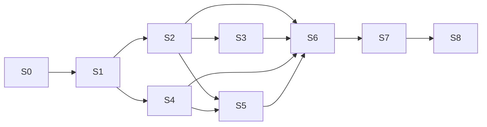

# Sprint execution and ownership

Nine bounded sprints replace a mixed legacy dashboard without rebuilding the storefront. All are initially planned; no implementation is authorized by the review itself. Roles are functional owners, not assumed hires.

| Sprint | Owner | Prerequisite | Reviewable outcome |
| --- | --- | --- | --- |
| [S0](S0.md) | Integration/security | None | Honest interim reporting; fail-closed auth/mode controls; unsafe execution visibly held until replacement. |
| [S1](S1.md) | Contracts/integration | S0 | Versioned contracts, compatibility and fixture oracle. |
| [S2](S2.md) | Financial | S1 | Durable payment/refund/dispute/fee authority and evidence-only reconciliation. |
| [S3](S3.md) | Postal operations | S2 | Safe shared submission and audited operator commands, postal/proof obligations. |
| [S4](S4.md) | Measurement | S1 | Actual journey/acquisition evidence, durable stage handoff and safe diagnostics/egress. |
| [S5](S5.md) | Commercial | S2, S4 | Offer continuity, tier-aware authority and budgeted redemptions. |
| [S6](S6.md) | Reporting | S2–S5 | Scoped evidence queries, honest economic reports, replay/shadow generations. |
| [S7](S7.md) | Experience | S6 | Executive overview, investigation/control areas, responsive accessible states. |
| [S8](S8.md) | Integration/release | S7 | Compatibility, rollback, evidence matrix and operator handoff; no deployment. |

Independent lanes: S2 and S4 can implement disjoint new modules after S1. S3 and S5 may implement their own modules after prerequisites, but shared checkout/order integration is serialized. Experience owner may produce fixture-only designs after S1; that does not complete S7 or authorize a dependent live dashboard. A single builder can simply run S0, S1, S2, S3, S4, S5, S6, S7, S8 sequentially.

Shared ownership rules:

| Shared surface | Single writer / ordering |
| --- | --- |
| `lib/types.ts`, contracts, Firebase helpers/rules/indexes | Integration owner integrates reviewed additive patches after schema freeze. Domain modules own private schemas only. |
| `lib/order-processor.ts`, paid/free dispatch wiring | S2 payment patch first; S3 postal integration second; S5 redemption hooks last. No concurrent edits. |
| `CheckoutModal`, workspace, lock endpoint | S4 emitter/touch helpers first, S5 owns final checkout/lock integration. S7 consumes, does not rewrite commerce semantics. |
| Telemetry ingest/schema and AttributionTracker | S4 after S1 contracts; reporting imports contracts, never forks definitions. |
| Admin page / existing widgets | S0 safety patch, then S7. S6 owns API facade, not UI layout. |
| Admin action auth/audit adapter | S0 fail-closed guard; S3 common capabilities/command framework; S5 registers commercial commands. |
| `progress.json` and coverage updates | Orchestrator/integration only; workers supply evidence in handoff files. |

Use isolated worktrees if later authorized parallel orchestration; ensure dependency commits are actually present before starting. Never overwrite unrelated changes. One reviewer should challenge oracle totals, user-visible evidence authority and money/postal side effects separately from the implementation author. The current planning turn did not spawn agents.

Definition of done: all ordered tasks and acceptance gates have commit-specific implementation and validation evidence; required review completed; compatible capabilities retained; local/staging/production status distinct. If a sprint expands, split it into named bounded child work packages and update dependencies/coverage/ledger before coding. Do not mark a partially verified sprint complete to advance the schedule.
