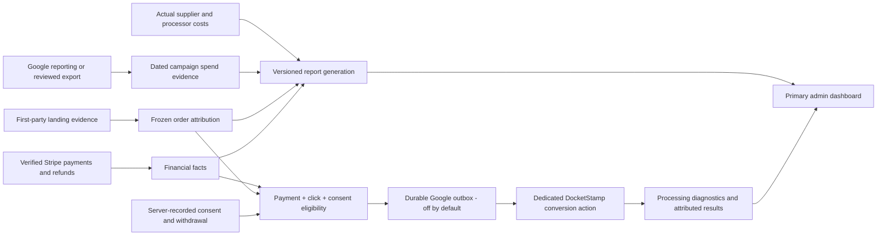

# SPRINT-0017 — Google experiment measurement and primary dashboard

**Status:** Active — refined plan approved for implementation and staging verification  
**Prepared:** 2026-11-10  
**Decision owner:** Zeke  
**Chapter:** CHAPTER-0001 — Reliable commerce and customer continuity  
**Execution authorization:** User approved Luna-agent implementation and staging deployment on 2026-11-10. Production deployment, live Google transmission/manual upload, campaign settings and recurring jobs remain held.

## Pyramid Index

- **L0:** Establish one evidence-based dashboard connecting Google spend, observed journeys, verified customer payments, first-order contribution and Google conversion delivery.
- **L1:** Promote Experiment and retire redundant analytics; reconcile spend and actual costs; build a consent-aware payment conversion path; validate on staging before separately approved production and Google activation.
- **L2:** [Baseline](#baseline-and-authority), [measurement contract](#measurement-contract), [releases](#implementation-plan-and-release-boundaries), [acceptance](#acceptance-tests), [review decisions](#decisions-for-separate-verification).

## Overview

The operator should be able to answer four questions from the default admin screen: What did we spend? What customer outcomes did it produce? Did first-order contribution cover acquisition spend? Did Google receive and attribute the eligible purchases?

Promote the existing Experiment report instead of building a second reporting engine. Preserve independent financial, acquisition and postal evidence. Full visibility means explainable coverage and gaps, not a promise that every visitor can be identified or every purchase attributed. Repeat usage and assumed LTV do not justify an uneconomic first purchase.

This began as a documentation-only planning deliverable; the user subsequently supplied an independent review and authorized execution to staging. The sprint-planning skill's Claude/Codex workflow stopped at preflight because the required Claude CLI was unavailable. No competing drafts or independent critiques were produced. The initial plan was a single-author draft, subsequently independently reviewed by the user; it is not represented as a completed multi-model planning run. The approved execution is registered in the existing JSON sprint ledger and chapter ledger. User-requested native Luna agents replace the skill's default CLI execution lane; the coordinator retains integration and review responsibility. No semantic index is configured.

## Baseline and authority

The canonical Master Build and Agentic Expansion specifications and AGENTS.md govern this work. Preserve all six invariants: fitness exclusion with permitted hardware OEMs; self-help positioning and mandatory disclosures; single-page USPS geometry; shared interpolation; immutable freeze-before-pay; and isolated Lob verification/dispatch modes. Template policy and payment/fulfillment authorization remain intact.

The fresh execution baseline check reconfirmed production commit `116a5ed81e9b20eb7301f66089cb8e464835be4d`, build `build-2026-11-10-002`, and staging on the same commit, build `build-2026-11-10-004`. Both deployments were re-read during execution preflight and still serve these revisions. Recheck before each staging rollout; the earlier `b6341b0` is not the current baseline.

Pre-sprint implementation baseline (not the post-sprint state):

- Distinct first-observed and current-session acquisition snapshots; sanitized order freezing; historical session-join fallback and explicit missing/conflicting evidence.
- Verified financial reporting, customer/QA classification, journey reporting and reviewed cost/spend ingestion.
- Experiment report in `ExecutiveReportingPanel`, currently under the internal `margins` tab. Default admin view is still the legacy `orders`/Command Center view.
- Raw click evidence has a seven-day expiry; first-touch observations have a thirty-day lifetime. Presence of click evidence is not consent or proof of a Google-attributed purchase.
- Google destinations remain disabled in the recorded production verification. The browser purchase path is blocked on sensitive routes, and no supported marketing-consent grant UI exists.

Pilot reference: account `2663982933`, campaign `24457739017`, key `google:cpc:ds_search_deposit_demand_pilot_01`, $150 total budget, Nov 10–16. Recorded final URL is `https://docketstamp.com/notices/security-deposit-return-demand-letter`, with suffix `utm_source=google&utm_medium=cpc&utm_campaign=ds_search_deposit_demand_pilot_01&utm_content={creative}`. Revalidate read-only before testing. Do not click the live ad to generate a test.

The emailed `AW-18474411963` / “Purchase - Verified Payment” snippet has not been established as the correct DocketStamp destination. The recorded DocketStamp action is “DocketStamp Paid Order - Not Connected.” Verify account ownership, conversion source, action ID, counting/window settings and isolation from SendMyNotes; never substitute another business's purchases.

Recent sprint context: 0014 addressed share previews and privacy boundaries; 0015 changed template copy; 0016 addressed mobile preparation and checkout ergonomics. This sprint builds on those journeys without reopening template prose or checkout design. CHAPTER-0001's operating-evidence direction fits; its broader roadmap does not enlarge this sprint.

## Use cases

1. Zeke opens admin and sees the current pilot's spend, verified purchases, contribution and data freshness without comparing conflicting dashboards.
2. An operator follows an unexplained funnel loss into bounded diagnostics or a paid order into payment/postal evidence.
3. A paid visitor returns directly; reporting preserves both touches and labels the assist without double-counting the purchase.
4. A customer grants or refuses advertising measurement independently of purchasing a mailing.
5. An eligible verified payment enters the Google queue once; failures, retries, acceptance and later attribution are visible.
6. A refunded order updates financial reporting and, where supported, the previously uploaded Google conversion value.

## Measurement contract

### Identity, cohort and attribution

- Use verified server financial facts for money and frozen order snapshots for attribution. Retain session joins only as a labeled fallback. Order status or browser purchase events do not establish paid eligibility.
- Default classification is live customers. Exclude founder, employee, automated test, complimentary and unresolved records from customer acquisition results; provide separate views and exclusion counts.
- Keep product entry surface separate from acquisition source. Campaign-tagged traffic is an observation, not independent proof of an ad click.
- Keep current-session attribution as the primary existing model. Show first-touch assists separately; do not add them to primary totals. A paid-to-direct return may be assisted while its current session is direct. A direct-to-paid return retains direct first touch and paid current session.
- If the two retained touches cannot establish an intermediate paid visit, show that limitation. Do not silently implement last-non-direct attribution, reconstruct deleted identifiers or rewrite frozen orders. Any alternative attribution model needs its own versioned rule and approval.
- Pilot preset uses account-local dates after timezone verification; maintain explicit UTC boundaries. Preserve the existing seven-day acquired-session outcome window, mark immature cohorts and show later refund adjustments separately. Reconcile Google click-date reporting separately from payment-date cash flow and internal session-cohort reporting.
- Keep ad clicks, observed sessions, converting sessions and paid orders distinct. Deduplicate orders across summary and channel views.

### Economics

| Metric | Definition and gate |
| --- | --- |
| Spend | Actual campaign expense with complete dated coverage, currency, source reference and revision history. Missing imports are not zero. |
| Net collections | Verified captures minus verified refunds and applicable reversals; no duplicate counting of related provider facts. |
| Contribution before ads | Cohort net collections less actual supplier/postage, processor and other incurred direct variable costs, including reprints where applicable. Estimates stay visibly separate. |
| Contribution after ads | Contribution before ads minus the same cohort's campaign spend; require complete relevant evidence. |
| Cost per paid order | Actual campaign spend / attributable paid orders. Undefined at zero orders. Do not call this customer CAC without established customer uniqueness. |
| Break-even acquisition cost | Actual contribution before ads / paid orders; no LTV uplift or speculative repeat revenue. |

Extend the existing supplier/processor cost schema only as needed to represent incurred direct costs, credits and corrections without double counting. Keep overhead/founder labor exclusions explicit. With zero purchases and a fully reconciled mature cohort, known spend is an acquisition loss; incomplete capture or attribution coverage cannot establish a definitive zero-purchase cohort. Broad filters must not subtract full campaign spend from a subset of orders without a supported allocation.

## Architecture

Reuse existing admin capabilities, command auditing, financial evidence and report publication. Introduce additive records for spend revisions, consent evidence and conversion deliveries. Reporting is not a fulfillment trigger. Google failures must never block payment, letter freezing or postal dispatch.

## Implementation plan and release boundaries

| Release | Scope | Completion gate | Authorization boundary |
| --- | --- | --- | --- |
| R0 — Verify baseline | Current deployments, code inventory, account/action mapping, provider access and evidence contracts | Dated baseline and unresolved dependencies recorded | Read-only discovery; no campaign edits |
| R1 — Dashboard consolidation | Promote Experiment; remove replaced UI; preserve operational tools | UI/navigation and operational regressions pass on staging | Production promotion separately approved |
| R2 — Complete scorecard | Spend/cost import, provider reconciliation coverage, campaign preset and quality states | Source totals and economic fixture matrix reconcile on staging | No Google conversion transmission; production separately approved |
| R3 — Google connection prepared | Consent controls, eligibility, durable outbox, adapter, diagnostics and refund handling | Local/staging tests and reviewed payload contract; delivery disabled | Customer-facing consent deployment and any external validation/transmission separately reviewed |
| R4 — Controlled activation | Confirm destination, authorize sender and reconcile real eligible purchases | Provider processing evidence and first real eligible attribution when available | Explicit Google activation approval; no bidding/budget/campaign setting changes |

R1 can ship independently of Google access. R2 may use reviewed exports while API access is unresolved. R3 must remain useful and testable with local fixtures; do not call a Google validation endpoint without the external-data gate, since validation still transmits a payload. R4 is an activation checklist, not implicit permission to execute it.

### R0 — Baseline and contracts

- Capture source/build IDs, current report schema, privacy behavior and dirty-file inventory. Preserve unrelated local files and detailed local release evidence.
- Revalidate the exact pilot URL and suffix; inspect an available real pilot landing without treating synthetic UTMs as a real click.
- Check Google reporting access read-only. Earlier API access was restricted to test accounts; current production access must be proven. Use an export fallback rather than making measurement contingent on access approval.
- Verify supported Data Manager action type, identifiers, consent fields, deduplication/adjustment behavior and processing diagnostics against current official docs. Record the exact destination and payload allowlist before implementing the adapter.

### R1 — Dashboard promotion and cleanup

| Existing surface | Action |
| --- | --- |
| `ExecutiveReportingPanel` / Experiment | Default Dashboard, first in desktop/mobile navigation; preserve old `margins` and Experiment link aliases |
| Command Center legacy KPI cards | Remove status-derived financial totals and unavailable session-conversion card; keep order counts only as operational inventory |
| `CampaignPerformanceWidget`, `VisitorTelemetryDashboard` | Remove after useful acquisition/stage diagnostics are covered by the report |
| `HighIntentCartsWidget` | Remove legacy aggregate recovery panel; preserve relevant checkout-failure diagnostics without adding outreach |
| `CohortAnalytics` | Consolidate useful notice/category breakdowns into report filtering |
| Legacy analytics/estimates accordion, unscoped ad-spend editor | Remove after dated evidence importer replaces the workflow |
| Lob and marketing configuration widgets | Move details to System Health; retain concise actionable alerts on Dashboard; configuration alone is not provider health |
| Orders, proof, recovery, incidents, email, discounts, SEO, templates | Preserve distinct useful capabilities; review callers before removing any backend |

Extract the order operations view as needed; avoid a broad admin rewrite. Stop fetching obsolete analytics on Dashboard, but retain required order APIs. Repair the Stripe reconciliation button's request/audit contract and misleading dispatch success copy: reconciliation does not initiate mailing. Remove or clearly disable the manual Lob sync action that currently returns held; restoring that provider capability is outside this sprint.

Delete unused imports/state/components and endpoints only after dependency searches and tests show no supported consumers. Retain historical data; UI cleanup is not a database purge.

### R2 — Scorecard and evidence ingestion

- Add a pilot preset, clear acquisition filters, paid/direct return assists, unknown buckets and cohort maturity. Keep one report source for cards, funnel and campaign table.
- Import campaign/day impressions, clicks and spend through a read-only adapter when accessible. Exclude unrelated account campaigns. Provide CSV/export preview, validation and audited commit as the fallback; no raw search queries are required for this release.
- Replace raw JSON cost entry with a reviewed import flow showing scope, currency, source dates, totals, duplicates, corrections and missing coverage. Define one canonical amount per source scope/revision; reject ambiguous overlaps, incomplete pagination and mixed currencies instead of summing them.
- Reconcile Stripe payment/refund facts and processor fees; reconcile supplier invoices/charges or reviewed exports to order IDs. Model late-arriving costs and corrections without changing immutable source facts.
- Publish source-specific watermarks and failures. Add bounded report refresh after successful ingestion, preserving the last complete report while a refresh fails. Any scheduled sync is separately configured and approved; none is installed by planning.
- Add a compact decision record: hypothesis, observed sample, maturity, evidence gaps and proposed next action. No automatic campaign changes or claims of statistical significance.

### R3 — Consent and verified-payment conversion path

- Build a first-party consent choice with equally usable refusal, withdrawal and no effect on checkout availability. Default no external transmission; honor GPC and storage denial. Store versioned server evidence bound to the eligible journey/order; never rely only on a forgeable local-storage string.
- Review exactly when raw clicks may be retained, the consent notice and withdrawal/deletion behavior before customer-facing release. Preserve the current seven-day maximum unless separately approved. Do not extend lifetime by copying raw identifiers into outbox payloads or logs; check expiry at send time and purge terminal/expired payloads.
- Keep the first-party thirty-day touch snapshot separate from seven-day click retention and Google upload eligibility. Near-expiry delivery can remain unavailable; do not increase retention silently to improve coverage. Past collection or continued use is not retroactive consent.
- Require a verified live capture bound to a genuine customer order, positive supported amount/currency, an eligible supported click, recorded consent and the verified DocketStamp destination. Recheck consent, expiry, refund state and kill switch immediately before sending.
- For the initial adapter, support only identifier types proven compatible with the selected destination; flag others as unsupported rather than guessing or substituting. Do not claim a hashed click can replace the raw click needed for matching.
- Payload allowlist: necessary Google click identifier, opaque stable transaction ID, payment timestamp, actual purchase value/currency, required consent fields and exact destination. Exclude email/phone hashes, names, addresses, document text, notice category, dispute details, account identifiers and URLs. No enhanced customer matching or remarketing.
- Browser tags remain gated and unnecessary on notice/order routes. Do not activate the existing blocked browser purchase event alongside the server sender. Removing a script after navigation is not proof that already-loaded vendor code stopped; this release should not enable general vendor scripts as a shortcut.
- Atomically create one logical delivery per environment/action/order; use leases, immutable payload versions, bounded retry/backoff and a visible terminal-failure state. Preserve stable IDs across timeout retries and distinguish original conversion retries from financial adjustments.
- Track `ineligible`, `queued`, `sending`, `submitted`, `accepted`, `rejected`, `retry_due`, `expired` and `cancelled` as appropriate. Store sanitized attempt metadata/provider request references. A transport success is not processing acceptance, and acceptance is not attributed reporting.
- Process verified full/partial refunds as supported retractions/restatements after the original outcome is resolved. Serialize adjustments; document actual API semantics before coding. If adjustments are unsupported or unverified, expose the gap and hold activation rather than silently reporting gross sales as net results.

### R4 — Activation and operating verification

Present the exact account/action, consent behavior, payload example, retention settings, queue controls, staging evidence and rollback switch for approval. Action creation or configuration changes require explicit review; do not reuse the emailed snippet by assumption. Do not change campaign goal associations or make an action primary as part of activation without a separate campaign-settings decision.

After activation, reconcile verified purchases → upload-eligible purchases → processed conversions → Google-attributed results. Explain differences due to consent, missing/expired clicks, refunds, date models, processing delay and attribution rules. Wait for a genuine eligible purchase; never fabricate a production purchase or click to close the gate. If no such purchase exists, mark R4 partially verified and leave the evidence gate open.

## Files summary

| Area | Existing paths / proposed additions |
| --- | --- |
| Admin navigation and cleanup | `app/admin/page.tsx`; `components/admin/ExecutiveReportingPanel.tsx`; legacy widgets listed in R1 |
| Reporting and imports | `lib/admin-console/reporting/{compute,store,scope,cost-evidence}.ts`; `app/api/admin/console/**`; obsolete `app/api/admin/ad-spend/route.ts` after caller audit |
| Payment authority/reconciliation | `lib/admin-console/finance/**`; `app/api/admin/sync-stripe/route.ts`; existing webhook integration points |
| Attribution and privacy | `lib/acquisition.ts`; `lib/acquisition-client.ts`; `lib/admin-console/measurement/{privacy,store}.ts`; `lib/marketing-privacy.ts`; `components/MarketingTags.tsx` |
| New bounded modules | Proposed `lib/admin-console/advertising/` for imports, eligibility, delivery and diagnostics; consent API/UI using existing authorization/session conventions |
| Persistence and tests | Additive indexes/TTL as needed; existing attribution, reporting, marketing-privacy and admin tests; new queue/consent/import tests |

Proposed paths may be refined at implementation review. Do not create a parallel payment ledger, reporting engine or fulfillment worker.

## Acceptance tests

| ID | Scenario | Required evidence |
| --- | --- | --- |
| A01 | Baseline | Current production/staging source/build and destination state recorded; unrelated files preserved |
| A02 | Primary dashboard | Default desktop/mobile view, old links, filters, loading/empty/stale/error states and keyboard navigation work |
| A03 | Cleanup | Removed cards/widgets no longer render or fetch; orders/proof/recovery/governance remain usable; dead endpoints have no supported callers |
| A04 | Pilot journey | Exact suffix through staging landing, workspace, frozen checkout and Stripe test payment; snapshot evidence retained; QA excluded |
| A05 | Returns and persistence | Direct→paid, paid→direct, refresh, duplicate events, storage denial, missing/malformed/conflicting parameters, expiry and cross-session boundaries preserve explicit uncertainty |
| A06 | Spend/import | Repeat uploads, corrected days, overlapping ranges, absent days, pagination failure, timezone boundaries and currency mismatch cannot inflate totals or manufacture completeness |
| A07 | Economics | Fixture covers spend with zero orders, unknown attribution, missing costs, partial/full refunds, reversals, later costs and scoped filters; source totals reconcile |
| A08 | Consent | Grant/refusal/withdrawal/GPC/storage denial and forged consent inputs; queued event cannot send after withdrawal or expiration |
| A09 | Eligibility | QA/test/free/unresolved/unpaid/mismatched orders and wrong destination excluded; verified eligible payment counted once |
| A10 | Queue | Duplicate webhooks, concurrent workers, timeout after provider receipt, transient/permanent failures, stale leases and kill switch preserve one logical purchase |
| A11 | Refunds | Full/partial and out-of-order refunds before/after submission update financial facts and versioned adjustments without duplicate purchases |
| A12 | Privacy | Network and serialized-payload inspection shows allowlisted fields only; no vendor loading on sensitive routes; logs/evidence exports contain no raw customer/click payloads |
| A13 | Google evidence | Submission, processing acceptance and attributed reporting separately verified; sandbox/validate-only results never presented as live attribution |
| A14 | Invariants and regression | Relevant attribution, reporting, privacy, admin and robustness suites pass; typecheck/build pass; checkout/fulfillment authority unchanged |

Use existing `test:attribution` and `test:robustness` scripts plus focused new tests and the repository's normal build/type checks. Browser evidence should include mobile and desktop screenshots and safe network assertions. Tests use Stripe test mode and Lob test/mock CASS. No production charge, mailing, email, paid ad click or Google customer-data upload is authorized for staging verification.

## Definition of Done and rollback

- Each releasable change has a reviewed diff, acceptance-to-evidence mapping, exact candidate revision, migration notes and rollback target.
- R1/R2 can be accepted while Google is blocked, but the overall Google connection is not called complete until R4's evidence gates pass.
- Production promotion uses the reviewed staging candidate after a fresh baseline check and explicit approval. Approval for this draft does not authorize all later external actions.
- Rollback disables Google delivery first, preserves financial/attribution history and delivery deduplication records, and rolls back application code without destructive schema changes. Never blindly resend uncertain deliveries after rollback.
- Store detailed customer/payment evidence privately; share sanitized summaries. Do not push unrelated local evidence or secrets.

## Risks, dependencies and mitigations

- **Production API access unavailable:** use reviewed exports; prove current access before promising automated sync. Reporting access and upload access are distinct dependencies.
- **Seven-day expiry and delayed payments:** expose lost upload eligibility; review any retention change separately. First-party reporting can remain useful without a Google upload.
- **Consent coverage and sparse traffic:** show the eligible share and sample size; do not treat missing Google conversions as missing customer sales.
- **Scope growth:** ship R1 and R2 independently. Defer unsupported identifiers, remarketing, bidding optimization and broader operational repairs.
- **Provider/account mismatch:** exact DocketStamp destination allowlist, environment isolation and no SendMyNotes fallback.
- **Financial corrections:** immutable source facts plus explicit revisions; preserve late refund visibility beyond the initial cohort window.
- **Incomplete historical evidence:** label gaps; no fabricated backfill, consent or clicks.

## Decisions for separate verification

Recommended defaults, pending reviewer confirmation:

1. Dashboard is the default; Orders and System Health retain operational responsibilities. Approve the R1 deletion/replacement inventory.
2. Keep current-session attribution primary and first-touch assists separate. Approve the seven-day cohort window and current retention ceiling; request a different versioned model explicitly if desired.
3. Prefer a dedicated server-side Google purchase integration with explicit consent and no customer matching. Confirm compatible action/identifier/adjustment support during R0.
4. Approve purchase revenue as Google's conversion value with refund adjustments; keep actual contribution as the internal decision metric. Do not substitute estimated profit without a separate value-policy decision.
5. Agree that exports are an acceptable initial spend source if production API access is unavailable, with freshness clearly visible.
6. Keep production promotion, customer-facing consent rollout, Google external validation/activation and campaign-settings changes as distinct decisions. Campaign budget and bidding remain unchanged throughout this sprint.

The separate reviewer should identify blockers, confirm the measurement formulas and consent/retention contract, and verify that every removed UI capability has a replacement or an explicit retirement decision. Record findings and resolved decisions before moving this draft into the executable sprint ledger.

## References

- [Master Build Specification](../DOCKETSTAMP_MASTER_BUILD_SPEC.md) and [Agentic Expansion Specification](../DOCKETSTAMP_AGENTIC_EXPANSION.md)
- [CHAPTER-0001](../chapters/CHAPTER-0001-reliable-commerce-and-customer-continuity.md)
- [Google Data Manager offline event contract](https://developers.google.com/data-manager/api/devguides/events/google-ads/offline/send-events), [conversion adjustments](https://developers.google.com/data-manager/api/devguides/events/google-ads/conversion-adjustments), and [processing diagnostics](https://developers.google.com/data-manager/api/reference/rest/v1/requestStatus/retrieve)
- [Google Ads production access levels](https://developers.google.com/google-ads/api/docs/api-policy/access-levels)

Google documentation was consulted during the preceding design review on 2026-11-10. Recheck the applicable contract/version and account capabilities at R0; documentation or API validation alone is not evidence that a live conversion was attributed.

## Approved review refinements — 2026-11-10

The user supplied an independent “Approve with 5 targeted operational refinements” review and requested Luna agents execute to staging. This section supersedes conflicting proposal wording above; R4 activation remains held.

1. **Navigation:** Dashboard; Orders & Fulfillment; System Health & Incidents; Templates & Coverage; secondary Discounts & Email. Keep SEO accessible as a secondary capability rather than deleting it. Preserve deep-link aliases and order inspector/recovery modals. Retire redundant widgets and their unscoped ad-spend editor/route after caller checks.
2. **Operational truth:** Fix Stripe reconciliation payload/audit requirements and success copy. Inspect actual fulfillment authority before disabling buttons: stale “Held” labels are not proof that the current retry backend is nonfunctional. Keep authorized, verified recovery; disable/remove the genuinely held manual Lob sync action.
3. **CSV fallback:** Implement a permissioned Google offline conversion CSV preparation/export path as well as the disabled adapter. It shares exact live-payment, consent, unexpired-click and destination checks with API delivery. Export is not upload or Google acceptance. Track export batches and reconciliation states to avoid sending the same purchase through CSV and API; never mark it accepted merely because a file downloaded. Initial Google Click ID CSV supports GCLID only; other IDs remain explicitly unsupported until their selected transport contract is verified. Require a separately reviewed destination/activation gate for real export; staging uses synthetic/test fixtures only. No live upload is authorized. Spreadsheet formula injection and raw-click exposure in logs must be tested.
4. **Consent:** Add unobtrusive first-party preferences available on notice/checkout without loading vendor code. Refusal and withdrawal remain usable and do not block purchases. First-party journey capture includes browser events: do not adopt the review's blanket claim that it is entirely server-side or legally exempt. Consent for Google transmission must be explicit and server-recorded. No legal-compliance conclusion is implied.
5. **Campaign extensibility:** Replace pilot-only import restriction with a bounded validated Google campaign key plus server-controlled campaign registry mapping platform IDs, canonical labels and currency/timezone. Do not store arbitrary URL campaign text, accept a regex as campaign identity, or broaden sensitive URL collection. Keep existing pilot mapping backward compatible. Unknown/unregistered campaign evidence is rejected or quarantined. Reviewed dated spend exports are the initial supported source; live API access remains separately verified.

**Additional acceptance:** CSV export/API handoff, repeated export, timeout/unknown upload outcomes, expired evidence, no-consent orders, unsupported identifiers, formula injection, unregistered campaign keys, dashboard aliases and current recovery authority all have focused tests. Destination/transport approval cannot be enabled by a browser request. No externally valid test conversions are fabricated.

**Execution ownership:** Luna UI lane owns admin navigation/retirement; Luna reporting lane owns report computation/import and campaign registry; Luna conversion lane owns consent/eligibility/outbox/export and safe integration. Coordinator resolves integration overlaps, verifies official provider contracts, runs integrated validation and deploys only staging. R4 is documented as held, not completed.

**R0 correction from source inspection:** `computeOrderSnapshotHash()` intentionally excludes attribution. Acquisition is frozen as its own sanitized order snapshot; this sprint does not claim it is cryptographically covered by the document/payment snapshot hash or change that hash contract. Current Google UI confirms the existing DocketStamp action source is Website, so offline destination compatibility/creation remains an R4 review dependency.

## Execution and release verification

R1/R2 deliver the default Dashboard, retirement of redundant widgets/unscoped spend editing, retained operational recovery, reviewed campaign/day spend and order-cost CSV import, coverage-aware economics and first-touch assists. R3 delivers server-recorded optional consent, a separate private conversion queue, authenticated diagnostics and default-off CSV/API scaffolding. Unknown/refused/withdrawn consent preserves sanitized campaign attribution but does not freeze advertising click identifiers for conversion delivery. The document/payment hash contract is unchanged.

Google activation is **not complete**. No approved destination exists in the registry; real export and API delivery remain disabled, and staging payments cannot pass live eligibility. Refund adjustments are recorded for review, not sent. Operator-driven delivery/reconciliation has no recurring worker installed. Acceptance of a provider request is distinct from attributed results. Production activation still requires the exact compatible DocketStamp action, authorized credentials, consent/data-handling review, real provider acceptance and refund/manual-upload reconciliation proof. API/manual-upload concurrency and ambiguous real-provider outcomes require activation-stage verification in addition to offline tests.

Release validation and staging verification results are recorded in [SPRINT-0017-VERIFICATION.md](SPRINT-0017-VERIFICATION.md). Production promotion and Google/campaign changes remain separately reviewable. Rollback is a staging rollout of the pre-sprint revision; preserve append-only money/consent/import evidence and do not delete historical records.
